# Voice AI

[Português](README.md) | [English](README.en.md)

A desktop voice assistant: it transcribes what you say, chats with an AI (by text or voice), shows images and videos in the answers and translates text, with most of it running on your own computer.

**Stack:** Electron + Vue 3 · FastAPI (Python) · Whisper (faster-whisper) · Claude · Edge TTS / ElevenLabs · Argos Translate

> The GIFs below were recorded with fictitious data. The app interface is in Portuguese (pt-BR).

---

## What it does

| Tab | What it does |
|-----|--------------|
| Microphone Transcription | Hold the hotkey, speak, release: the text is transcribed by local Whisper and copied to the clipboard |
| Transcribe File | Pick or drag an audio or video file and get the full transcription |
| AI Chat | Chat with Claude by text or voice, with spoken answers, images, videos and attachments |
| Translate | Offline translation between dozens of languages |
| Logs | History of every transcription, with model, device and speed |
| Settings | Hotkeys, Whisper models, voice, Claude, images and storage |

---

## Features in action

<table>
  <tr>
    <td width="49%" valign="top" align="center"><b>Microphone Transcription</b><br/><sub>Live state, audio level, progress, the latest transcription and the two before it. The current hotkey shows at the top.</sub></td>
    <td width="2%"></td>
    <td width="49%" valign="top" align="center"><b>Transcribe a file</b><br/><sub>MP3, OGG, WAV, M4A, video and more, with progress, duration, processing time and the full text. All local.</sub></td>
  </tr>
  <tr>
    <td align="center"><a href="docs/gifs/microfone.gif">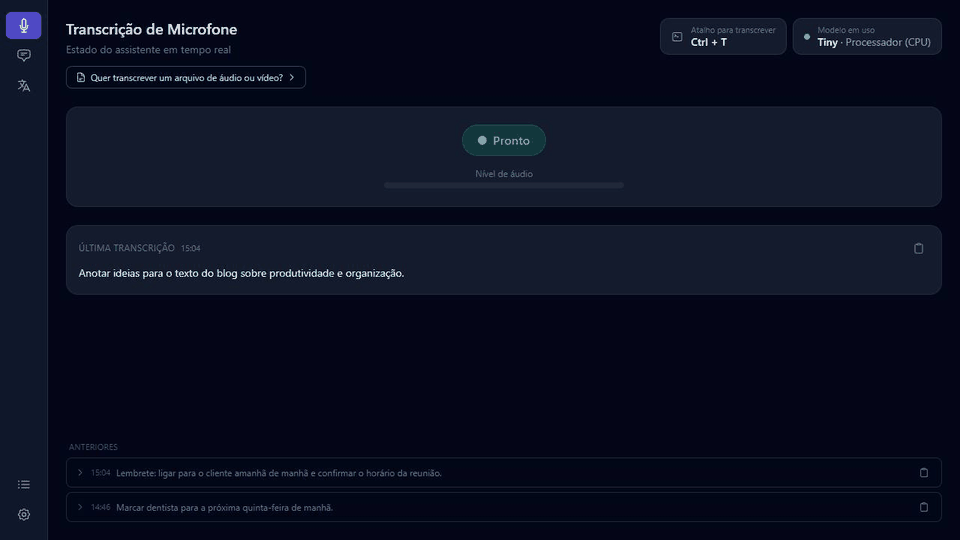</a></td>
    <td width="2%"></td>
    <td align="center"><a href="docs/gifs/arquivo.gif">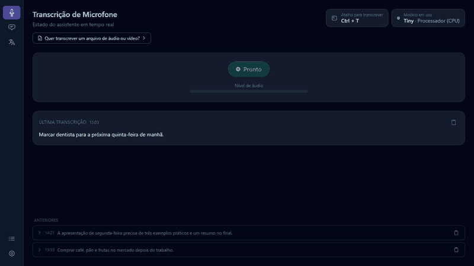</a></td>
  </tr>
  <tr>
    <td width="49%" valign="top" align="center"><b>Offline translation</b><br/><sub>English and Portuguese (and dozens more) without internet. The middle button swaps the direction.</sub></td>
    <td width="2%"></td>
    <td width="49%" valign="top" align="center"><b>Ask by voice</b><br/><sub>While you hold the AI hotkey, the live transcription fills the chat input. On release the question is sent and the answer arrives already spoken.</sub></td>
  </tr>
  <tr>
    <td align="center"><a href="docs/gifs/traducao.gif">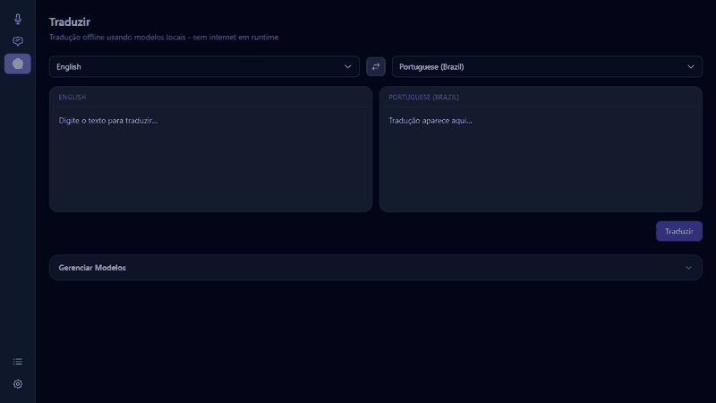</a></td>
    <td width="2%"></td>
    <td align="center"><a href="docs/gifs/voz.gif">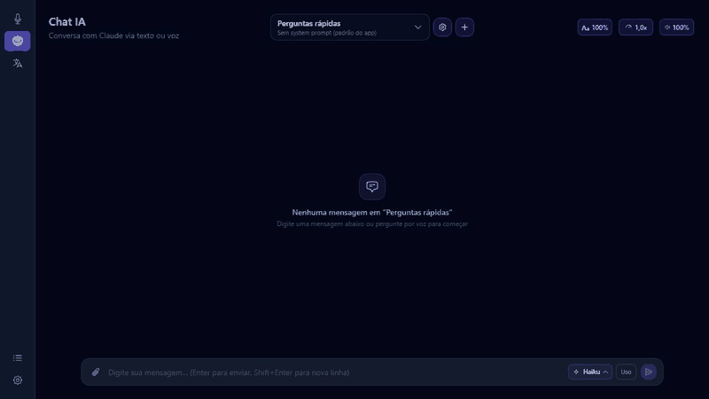</a></td>
  </tr>
  <tr>
    <td width="49%" valign="top" align="center"><b>Chat with images</b><br/><sub>The AI shows images when it helps. A preview first, then a second AI checks each image and writes the caption.</sub></td>
    <td width="2%"></td>
    <td width="49%" valign="top" align="center"><b>Chat with videos</b><br/><sub>Same for YouTube videos: thumbnail, duration, title and channel. The video opens in your browser.</sub></td>
  </tr>
  <tr>
    <td align="center"><a href="docs/gifs/chat_imagens.gif">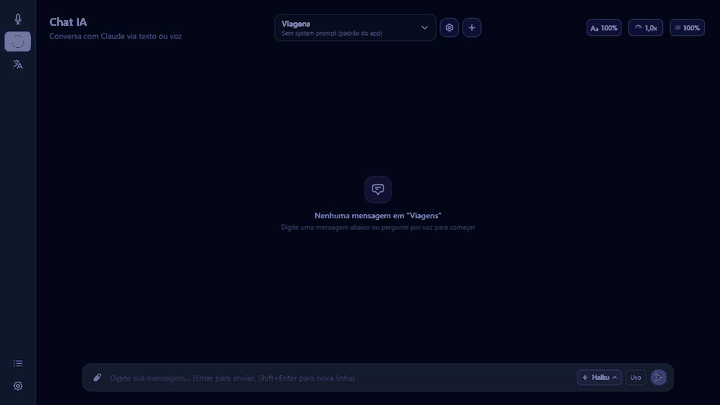</a></td>
    <td width="2%"></td>
    <td align="center"><a href="docs/gifs/chat_videos.gif">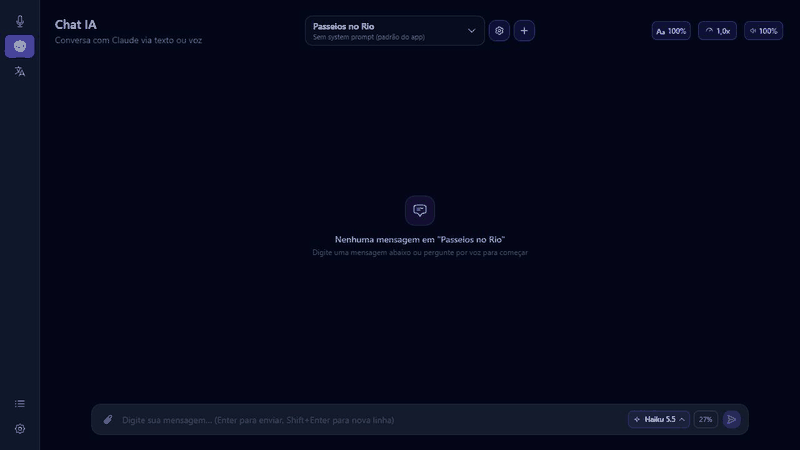</a></td>
  </tr>
  <tr>
    <td width="49%" valign="top" align="center"><b>Search again and refine by voice</b><br/><sub>Search again finds other images without repeating. Refine lets you describe by voice what you want to see (e.g. only night photos).</sub></td>
    <td width="2%"></td>
    <td width="49%" valign="top" align="center"><b>Attachments</b><br/><sub>Attach images or text files and ask about them. The size limit is configurable.</sub></td>
  </tr>
  <tr>
    <td align="center"><a href="docs/gifs/refinar.gif">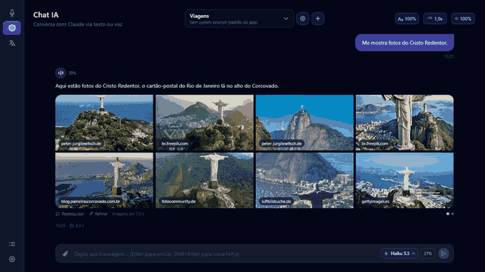</a></td>
    <td width="2%"></td>
    <td align="center"><a href="docs/gifs/anexos.gif">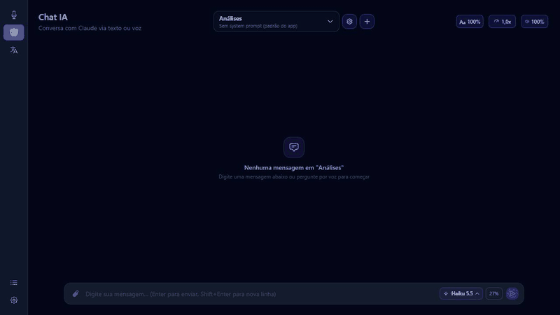</a></td>
  </tr>
  <tr>
    <td width="49%" valign="top" align="center"><b>AI-written system prompt</b><br/><sub>Say what you want and the AI writes the chat's system prompt. Then review it, ask for tweaks or save it.</sub></td>
    <td width="2%"></td>
    <td width="49%" valign="top" align="center"><b>Logs</b><br/><sub>Every transcription with source, model, where it ran, duration and speed. Click a row to read the full text.</sub></td>
  </tr>
  <tr>
    <td align="center"><a href="docs/gifs/prompt.gif">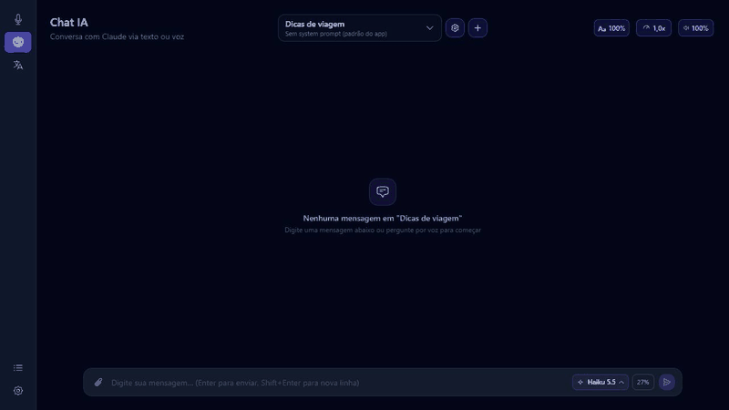</a></td>
    <td width="2%"></td>
    <td align="center"><a href="docs/gifs/logs.gif">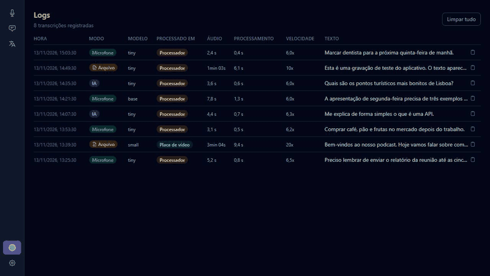</a></td>
  </tr>
  <tr>
    <td width="49%" valign="top" align="center"><b>Settings</b><br/><sub>Hotkeys, Whisper model, voice, sounds, Claude model, plan usage, image search and storage.</sub></td>
    <td width="2%"></td>
    <td width="49%"></td>
  </tr>
  <tr>
    <td align="center"><a href="docs/gifs/config.gif">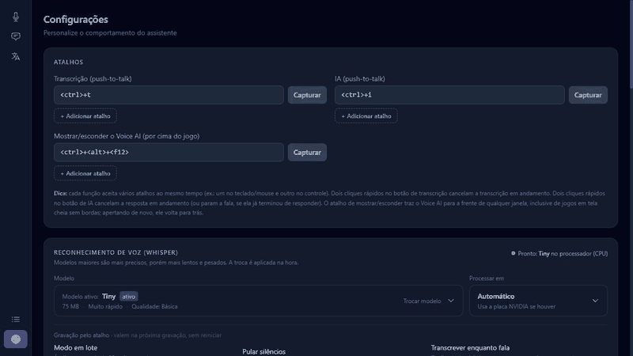</a></td>
    <td width="2%"></td>
    <td align="center"></td>
  </tr>
</table>

---

## Installation

### Windows (installer)

1. Run `Voice AI Setup x.y.z.exe` (about 180 MB).
2. On first launch, a setup screen downloads what is missing, with progress:
   - translation engine (~170 MB);
   - Whisper tiny model (~75 MB);
   - optional: CUDA libraries to use an NVIDIA GPU (~1.3 GB);
   - optional: Claude Code, required for the AI Chat.
3. Done. Your data lives in `%APPDATA%\voice-ai`.

Larger Whisper models and translation languages are downloaded later, inside the app, whenever you want.

### From source

Requirements: Python 3.11+, Node.js 18+, `ffmpeg`, a microphone. An NVIDIA GPU with CUDA is optional (without it Whisper runs on the CPU).

```bash
git clone https://github.com/alanazeredoguedes/voice-ai.git
cd voice-ai

# Backend
cd backend
python -m venv venv
# Windows: venv\Scripts\activate    Linux/macOS: source venv/bin/activate
pip install -r requirements.txt
cd ..

# Frontend
cd frontend
npm install
```

### Run in development

```bash
./dev.sh        # Linux/macOS
dev.bat         # Windows (or dev.ps1)
```

Or manually, in two terminals: `python -m backend.main` (from the repo root, venv active) and `npm run dev` (inside `frontend`).

### Build the installer

```powershell
.\build.ps1     # Windows: produces frontend\dist\Voice AI Setup x.y.z.exe
./build.sh      # Linux: AppImage
```

The Windows installer ships Python and the core libraries inside it. The heavy parts (PyTorch/translation engine, Whisper model, CUDA) are downloaded on first run to keep the installer small.

---

## How it works

```
┌─────────────────────────────────────────────────┐
│                 Electron (frontend)              │
│   Vue 3 + Pinia + Tailwind CSS                   │
│   WebSocket (port 18450) ←→ HTTP REST            │
└──────────────────┬──────────────────────────────┘
                   │
┌──────────────────▼──────────────────────────────┐
│                FastAPI (backend)                 │
│                                                  │
│  HotkeyManager ──► SpeechEngine (Whisper)        │
│        │               │                         │
│        ▼               ▼                         │
│   Orchestrator ──► ClaudeBrain (streaming)       │
│        │               │                         │
│        │         MediaSearch + MediaJudge        │
│        └──► TextToSpeech (Edge / ElevenLabs)     │
│                                                  │
│            SQLite  (chats, logs)                 │
└─────────────────────────────────────────────────┘
```

**Hotkey transcription:** hold the hotkey, audio is captured, on release Whisper transcribes locally, the text goes to the clipboard and shows on screen. With "transcribe while speaking" on, text is produced during the recording.

**Asking the AI:** hold the AI hotkey and speak. The question is transcribed (and appears in the chat input while you talk), Claude answers in streaming, each sentence becomes audio in parallel and starts playing as soon as it is ready. The conversation is saved in the chat.

**Images and videos:** when you ask for them, or when they help the explanation, the AI marks in its answer what it wants to show. The app searches (DuckDuckGo, no key, or Google Images through Serper, with a key), shows a preview, and a Haiku model checks each result and writes the caption.

---

## Hotkeys

| Action | Default | Behavior |
|--------|---------|----------|
| Transcribe | `Ctrl + T` (hold) | Records while pressed, release to transcribe |
| Talk to the AI | `Ctrl + I` (hold) | Same, but the question goes to the chat |
| Show/hide Voice AI | `Ctrl + Alt + F12` | Brings the app to the front, even over borderless fullscreen games |
| Cancel | two quick presses of the hotkey | Cancels the recording or stops the AI answer |

Hotkeys can be keys, mouse buttons or combinations, and each action accepts more than one. Set them in **Settings → Hotkeys → Capture**.

---

## Main settings

Settings live in `settings.json` inside the data folder (`%APPDATA%\voice-ai` on Windows, `~/.local/share/voice-ai` in development on Linux). Almost everything is adjustable from the Settings screen.

| Key | Default | Description |
|-----|---------|-------------|
| `model` | `tiny` | Whisper model (`tiny`, `base`, `small`, `medium`, `large-v3`...) |
| `device` | `auto` | `auto`, `cuda` (NVIDIA) or `cpu` |
| `transcription_key` / `ai_key` | `Ctrl+T` / `Ctrl+I` | Transcription and AI hotkeys |
| `whisper_batched` | `true` | Batch mode: audio over 30 s is split and processed together |
| `whisper_stream` | `true` | Transcribe while speaking |
| `whisper_vad` | `false` | Skip silences |
| `tts_backend` | `edge` | `edge` (free) or `elevenlabs` (paid) |
| `edge_voice` | `pt-BR-AntonioNeural` | Edge TTS voice |
| `claude_model` | `haiku` | Claude model in the chat: `haiku`, `sonnet` or `opus` |
| `media_enabled` | `true` | Show images and videos in the chat |
| `media_max_images` | `8` | Images per search |
| `media_proactive` | `true` | The AI may send images and videos on its own |
| `web_search` | `true` | The AI may search the internet |
| `upload_limit_mb` | `2` | Maximum size of each chat attachment |
| `speech_cache_limit_mb` | `20` | Limit of stored audio per chat |
| `serper_api_key` | empty | Optional key for Google image search (Serper) |
| `elevenlabs_api_key` | empty | Optional ElevenLabs key |

### Whisper models

Downloaded inside the app, under **Settings → Speech recognition**.

| Model | Size | Speed | Quality |
|-------|------|-------|---------|
| `tiny` | ~75 MB | very fast | basic |
| `base` | ~145 MB | very fast | good |
| `small` | ~460 MB | fast | good |
| `medium` | ~1.5 GB | medium | very good |
| `large-v3` | ~3 GB | slow | excellent |

Not sure which to use? The **Test performance** button compares the models on your computer.

### Voice (TTS)

- **Edge TTS** (default, free): Microsoft neural voices, needs internet.
- **ElevenLabs** (paid): create a key at elevenlabs.io, paste it in **Settings → Voice synthesis** and pick a voice.

---

## Project layout

```
voice-ai/
├── backend/
│   ├── main.py                # FastAPI + WebSocket
│   ├── orchestrator.py        # Coordinates Whisper, Claude, TTS and hotkeys
│   ├── routes/                # chat, media, transcribe, translate, models, settings, logs...
│   ├── services/
│   │   ├── brain.py           # Claude (streaming)
│   │   ├── speech_engine.py   # faster-whisper + audio capture
│   │   ├── tts.py             # Edge TTS / ElevenLabs
│   │   ├── media_search.py    # image and video search
│   │   ├── media_judge.py     # image checking and captions
│   │   ├── prompt_gen.py      # AI-written system prompt
│   │   └── hotkey_manager.py  # keyboard, mouse and gamepad hotkeys
│   └── requirements*.txt
├── frontend/
│   ├── src/main/              # Electron main process (setup, backend)
│   ├── src/renderer/src/      # views, stores (Pinia), components, API
│   └── electron-builder.yml
├── tools/                     # build helpers
├── build.ps1 / build.sh       # build the installer
├── dev.ps1 / dev.sh           # run in development
└── docs/gifs/                 # GIFs used in this README
```

---

## Troubleshooting

- **The AI Chat does not answer:** Claude Code must be installed and logged in. The first-run setup installs it; you log in once.
- **Slow transcription:** use a smaller model or enable the NVIDIA GPU (CUDA) in **Settings → Run on**.
- **Translate asks to install languages:** expected, each language pair is downloaded once.
- **Port in use:** the app uses port `18450`; close any other Voice AI instance.

---

## Roadmap

- [x] Windows build with installer and first-run setup
- [x] Whisper model download inside the app
- [ ] AMD GPU support (ROCm)
- [ ] A proper app icon
