# Voice AI

[Português](README.md) | [English](README.en.md)

A desktop voice assistant: it transcribes what you say, chats with an AI (by text or voice), shows images and videos in the answers, translates text and whole documents (PDF, Word, PowerPoint...) keeping their layout, and makes voice calls with screen sharing directly between participants. Most of it runs on your own computer.

**Stack:** Electron + Vue 3 · FastAPI (Python) · Whisper (faster-whisper) · Claude · Edge TTS / ElevenLabs · Argos Translate · PyMuPDF · WebRTC + Cloudflare Tunnel

> The GIFs below were recorded with fictitious data. The app interface is in Portuguese (pt-BR).

---

## What it does

| Tab | What it does |
|-----|--------------|
| Microphone Transcription | Hold the hotkey, speak, release: the text is transcribed by local Whisper and copied to the clipboard |
| Transcribe File | Pick or drag an audio or video file and get the full transcription |
| AI Chat | Chat with Claude by text or voice, with spoken answers, images, videos and attachments |
| Translate | Offline translation of text and files (PDF, DOCX, PPTX, XLSX, TXT, MD, SRT), keeping the original layout |
| Call | Voice rooms with screen sharing (with sound), chat and file transfer, all directly between participants (P2P) |
| Logs | History of every transcription, with model, device and speed |
| Settings | Hotkeys, Whisper models, voice, Claude, images and storage |

---

## Features in action

<table>
  <tr>
    <td width="49%" valign="top" align="center"><b>Microphone Transcription</b><br/><sub>Live state, audio level, progress, the latest transcription and the two before it. The current hotkey shows at the top.</sub></td>
    <td width="2%"></td>
    <td width="49%" valign="top" align="center"><b>Transcribe a file</b><br/><sub>MP3, OGG, WAV, M4A, video and more, with progress, duration, processing time and the full text. All local.</sub></td>
  </tr>
  <tr>
    <td align="center"><a href="docs/gifs/microfone.gif">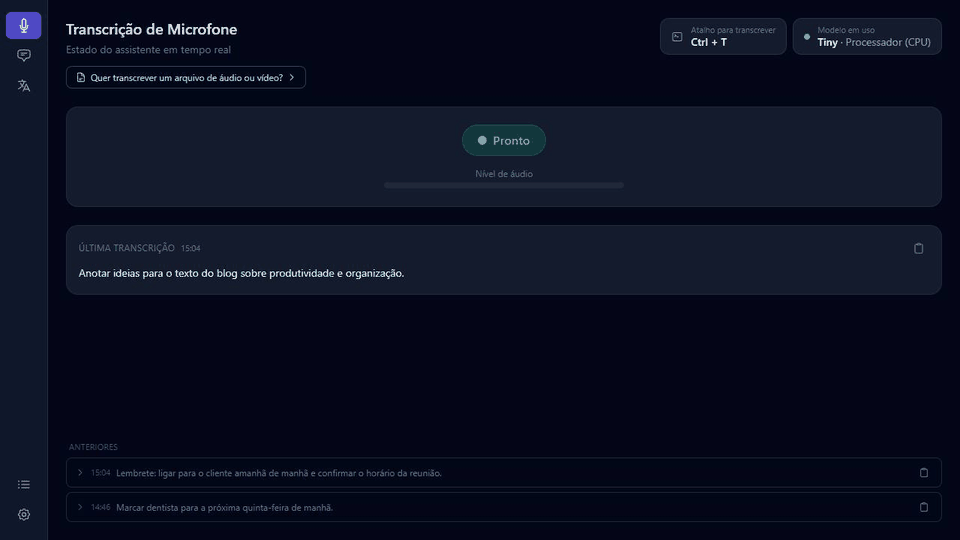</a></td>
    <td width="2%"></td>
    <td align="center"><a href="docs/gifs/arquivo.gif">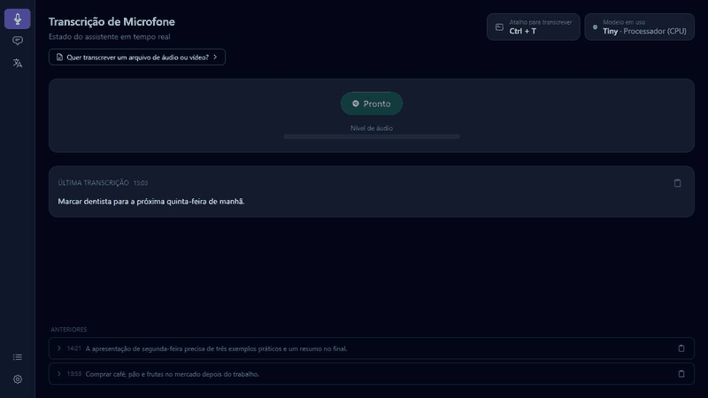</a></td>
  </tr>
  <tr>
    <td width="49%" valign="top" align="center"><b>Offline translation</b><br/><sub>English and Portuguese (and dozens more) without internet. The middle button swaps the direction.</sub></td>
    <td width="2%"></td>
    <td width="49%" valign="top" align="center"><b>Ask by voice</b><br/><sub>While you hold the AI hotkey, the live transcription fills the chat input. On release the question is sent and the answer arrives already spoken.</sub></td>
  </tr>
  <tr>
    <td align="center"><a href="docs/gifs/traducao.gif">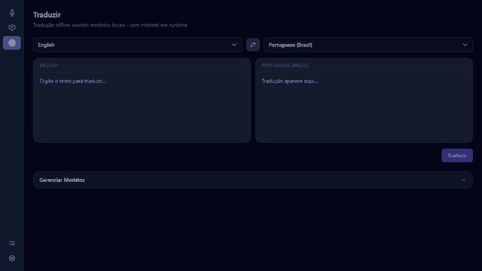</a></td>
    <td width="2%"></td>
    <td align="center"><a href="docs/gifs/voz.gif">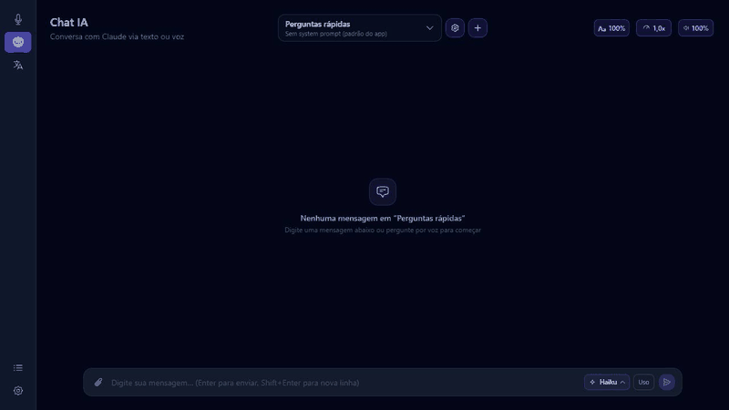</a></td>
  </tr>
  <tr>
    <td width="49%" valign="top" align="center"><b>Chat with images</b><br/><sub>The AI shows images when it helps. A preview first, then a second AI checks each image and writes the caption.</sub></td>
    <td width="2%"></td>
    <td width="49%" valign="top" align="center"><b>Chat with videos</b><br/><sub>Same for YouTube videos: thumbnail, duration, title and channel. The video opens in your browser.</sub></td>
  </tr>
  <tr>
    <td align="center"><a href="docs/gifs/chat_imagens.gif">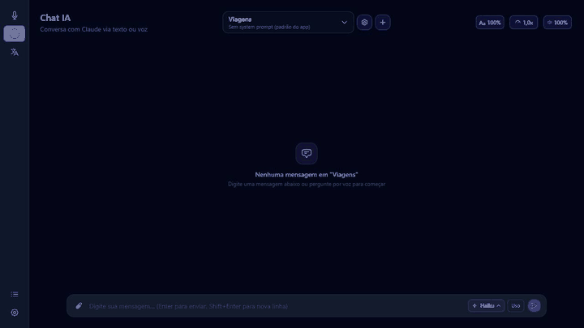</a></td>
    <td width="2%"></td>
    <td align="center"><a href="docs/gifs/chat_videos.gif">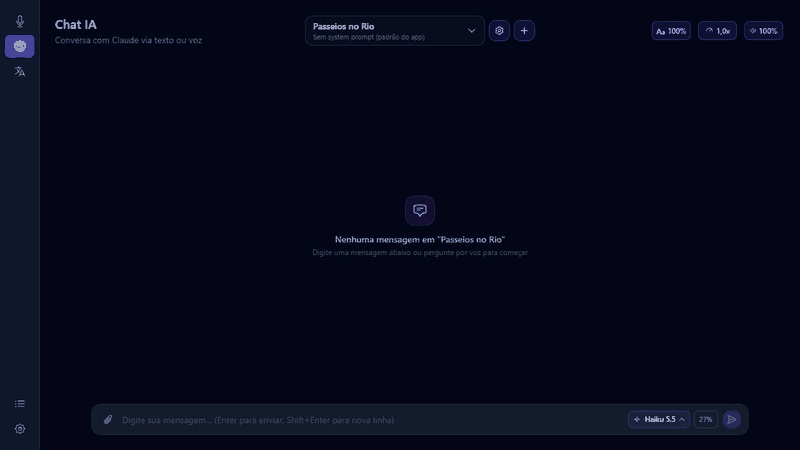</a></td>
  </tr>
  <tr>
    <td width="49%" valign="top" align="center"><b>Search again and refine by voice</b><br/><sub>Search again finds other images without repeating. Refine lets you describe by voice what you want to see (e.g. only night photos).</sub></td>
    <td width="2%"></td>
    <td width="49%" valign="top" align="center"><b>Attachments</b><br/><sub>Attach images or text files and ask about them. The size limit is configurable.</sub></td>
  </tr>
  <tr>
    <td align="center"><a href="docs/gifs/refinar.gif">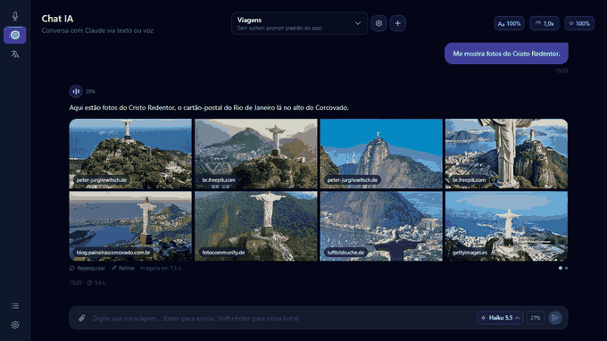</a></td>
    <td width="2%"></td>
    <td align="center"><a href="docs/gifs/anexos.gif">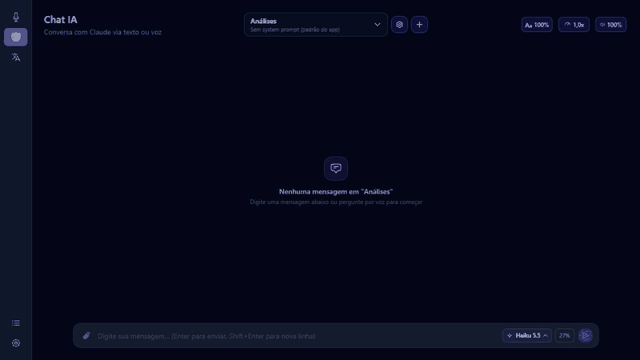</a></td>
  </tr>
  <tr>
    <td width="49%" valign="top" align="center"><b>AI-written system prompt</b><br/><sub>Say what you want and the AI writes the chat's system prompt. Then review it, ask for tweaks or save it.</sub></td>
    <td width="2%"></td>
    <td width="49%" valign="top" align="center"><b>Logs</b><br/><sub>Every transcription with source, model, where it ran, duration and speed. Click a row to read the full text.</sub></td>
  </tr>
  <tr>
    <td align="center"><a href="docs/gifs/prompt.gif">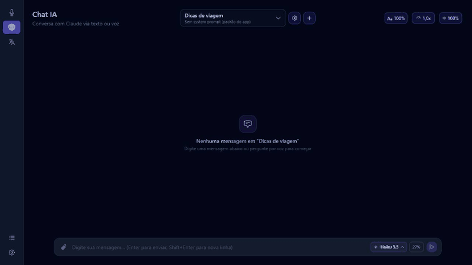</a></td>
    <td width="2%"></td>
    <td align="center"><a href="docs/gifs/logs.gif">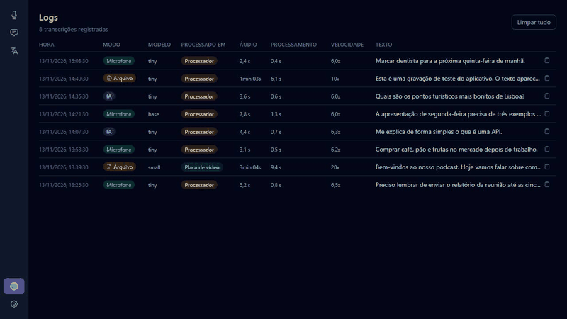</a></td>
  </tr>
  <tr>
    <td width="49%" valign="top" align="center"><b>Settings</b><br/><sub>Hotkeys, Whisper model, voice, sounds, Claude model, plan usage, image search and storage.</sub></td>
    <td width="2%"></td>
    <td width="49%"></td>
  </tr>
  <tr>
    <td align="center"><a href="docs/gifs/config.gif">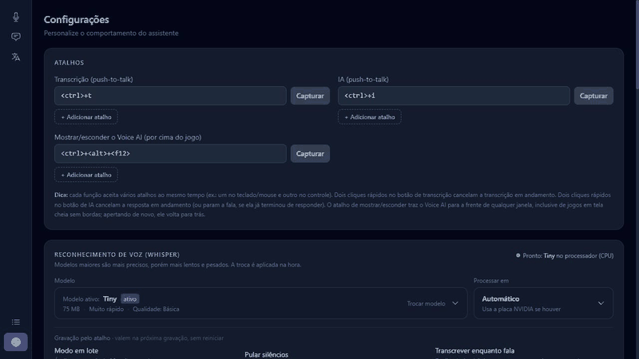</a></td>
    <td width="2%"></td>
    <td align="center"></td>
  </tr>
</table>

---

## Installation

Download the latest version from [Releases](https://github.com/alanazeredoguedes/voice-ai/releases): the `.exe` for Windows or the `.AppImage` for Linux.

### Windows (installer)

1. Run `Voice AI Setup x.y.z.exe` (about 180 MB).
2. On first launch, a setup screen asks for confirmation and downloads what is missing, with progress:
   - translation engine and file translation components (PyMuPDF, lxml);
   - Whisper tiny model (~75 MB);
   - `cloudflared`, used to create rooms in the Call tab (~40 MB);
   - optional: CUDA libraries to use an NVIDIA GPU (~1.3 GB);
   - optional: Claude Code, required for the AI Chat.
3. Done. Your data lives in `%APPDATA%\voice-ai`.

### Linux (AppImage)

```bash
chmod +x Voice.AI-x.y.z.AppImage
./Voice.AI-x.y.z.AppImage
```

On first launch, the same setup screen downloads the Python components (on Linux they are not inside the AppImage, so the download is bigger) and the rest of the list above. Your data lives in `~/.config/voice-ai`.

**Linux with Wayland** (Ubuntu's default): the system does not hand a program the keys and clicks made in other programs, so global hotkeys need a permission. The app shows a notice with an **Allow hotkeys** button (labeled *Liberar atalhos*): Ubuntu asks for the password once and a udev rule (`/etc/udev/rules.d/72-voice-ai-input.rules`) gives the person using the computer read access to the keyboard and mouse. From then on the app reads both directly (`/dev/input`) and hotkeys work anywhere, as on X11, without logging out. Keys still reach the other programs normally.

**Settings → General** lets you **start with the system** (Windows and Linux). When a new app version needs new components, it asks to update on launch and downloads only what is missing.

Larger Whisper models and translation languages are downloaded later, inside the app, whenever you want.

### From source

Requirements: Python 3.11+, Node.js 18+, `ffmpeg`, a microphone. An NVIDIA GPU with CUDA is optional (without it Whisper runs on the CPU).

```bash
git clone https://github.com/alanazeredoguedes/voice-ai.git
cd voice-ai

# Backend
cd backend
python -m venv venv
# Windows: venv\Scripts\activate    Linux/macOS: source venv/bin/activate
pip install -r requirements.txt
cd ..

# Frontend
cd frontend
npm install
```

### Run in development

```bash
./dev.sh        # Linux/macOS
dev.bat         # Windows (or dev.ps1)
```

Or manually, in two terminals: `python -m backend.main` (from the repo root, venv active) and `npm run dev` (inside `frontend`).

Development mode is **isolated from the installed app**: it uses port `18451` (the installed app uses `18450`) and its own folders (`~/.config/voice-ai-dev` for Electron and `~/.local/share/voice-ai` for the backend, with separate Whisper models and translation packages). Both can run at the same time, and deleting one does not affect the other. The backend does not auto-reload: after changing Python code, run `dev.sh` again.

### Build the installer

```powershell
.\build.ps1     # Windows: produces frontend\dist\Voice AI Setup x.y.z.exe
./build.sh      # Linux: AppImage
```

The Windows installer ships Python and the core libraries inside it. The heavy parts (PyTorch/translation engine, file translation, Whisper model, CUDA, cloudflared) are downloaded on first run to keep the installer small. The AppImage ships Python; the libraries are downloaded on first run.

---

## How it works

```
┌─────────────────────────────────────────────────┐
│                 Electron (frontend)              │
│   Vue 3 + Pinia + Tailwind CSS                   │
│   WebSocket (port 18450) ←→ HTTP REST            │
│   Call: WebRTC (P2P) + signaling/tunnel          │
└──────────────────┬──────────────────────────────┘
                   │
┌──────────────────▼──────────────────────────────┐
│                FastAPI (backend)                 │
│                                                  │
│  HotkeyManager ──► SpeechEngine (Whisper)        │
│        │               │                         │
│        ▼               ▼                         │
│   Orchestrator ──► ClaudeBrain (streaming)       │
│        │               │                         │
│        │         MediaSearch + MediaJudge        │
│        └──► TextToSpeech (Edge / ElevenLabs)     │
│                                                  │
│  Translation: Argos (text) + PyMuPDF / lxml      │
│               (PDF, Word, PowerPoint, Excel)     │
│                                                  │
│            SQLite  (chats, logs)                 │
└─────────────────────────────────────────────────┘
```

Each tab is explained in detail under [Features](#features). In short: Electron renders the interface and talks to the Python backend (FastAPI) over the local port; the backend handles Whisper, Claude, voice and translation. The Call is the exception: its networking lives entirely in Electron and the backend is not involved.

---

## Hotkeys

| Action | Default | Behavior |
|--------|---------|----------|
| Transcribe | `Mouse 9` (hold) | Records while pressed, release to transcribe |
| Talk to the AI | `Ctrl + Mouse 9` (hold) | Same, but the question goes to the chat |
| Show/hide Voice AI | `Ctrl + Mouse 8` | Brings the app to the front, even over borderless fullscreen games ("always on top" option next to the hotkey) |
| Talk in the call | `Mouse 8` (hold) | With **Push to talk** on in the Call, the microphone only transmits while you hold it |
| Cancel | two quick presses of the hotkey | Cancels the recording or stops the AI answer |

`Mouse 8` and `Mouse 9` are the side mouse buttons (back and forward). Hotkeys can be keys, mouse buttons or combinations, and each action accepts more than one. Set them in **Settings → Hotkeys → Capture**.

---

## Main settings

Settings live in `settings.json` inside the data folder (`%APPDATA%\voice-ai` on Windows, `~/.config/voice-ai` for the AppImage, `~/.local/share/voice-ai` in development). Almost everything is adjustable from the Settings screen.

| Key | Default | Description |
|-----|---------|-------------|
| `model` | `tiny` | Whisper model (`tiny`, `base`, `small`, `medium`, `large-v3`...) |
| `device` | `auto` | `auto`, `cuda` (NVIDIA) or `cpu` |
| `transcription_key` / `ai_key` | `Mouse 9` / `Ctrl + Mouse 9` | Transcription and AI hotkeys |
| `window_key` / `call_ptt_key` | `Ctrl + Mouse 8` / `Mouse 8` | Show/hide and talk-in-call hotkeys |
| `whisper_batched` | `true` | Batch mode: audio over 30 s is split and processed together |
| `whisper_stream` | `true` | Transcribe while speaking |
| `whisper_vad` | `false` | Skip silences |
| `tts_backend` | `edge` | `edge` (free) or `elevenlabs` (paid) |
| `edge_voice` | `pt-BR-AntonioNeural` | Edge TTS voice |
| `claude_model` | `sonnet` | Claude model in the chat: `haiku`, `sonnet` or `opus` |
| `window_keep_on_top` | `false` | The show hotkey keeps the window always on top |
| `media_enabled` | `true` | Show images and videos in the chat |
| `media_max_images` | `8` | Images per search |
| `media_proactive` | `true` | The AI may send images and videos on its own |
| `web_search` | `true` | The AI may search the internet |
| `upload_limit_mb` | `2` | Maximum size of each chat attachment |
| `speech_cache_limit_mb` | `20` | Limit of stored audio per chat |
| `serper_api_key` | empty | Optional key for Google image search (Serper) |
| `elevenlabs_api_key` | empty | Optional ElevenLabs key |

### Whisper models

Downloaded inside the app, under **Settings → Speech recognition**.

| Model | Size | Speed | Quality |
|-------|------|-------|---------|
| `tiny` | ~75 MB | very fast | basic |
| `base` | ~145 MB | very fast | good |
| `small` | ~460 MB | fast | good |
| `medium` | ~1.5 GB | medium | very good |
| `large-v3` | ~3 GB | slow | excellent |

Not sure which to use? The **Test performance** button compares the models on your computer.

### Voice (TTS)

- **Edge TTS** (default, free): Microsoft neural voices, needs internet.
- **ElevenLabs** (paid): create a key at elevenlabs.io, paste it in **Settings → Voice synthesis** and pick a voice.

---

## Project layout

```
voice-ai/
├── backend/
│   ├── main.py                # FastAPI + WebSocket
│   ├── orchestrator.py        # Coordinates Whisper, Claude, TTS and hotkeys
│   ├── routes/                # chat, media, transcribe, translate, translate_files, models, storage...
│   ├── services/
│   │   ├── brain.py           # Claude (streaming)
│   │   ├── file_translate.py  # PDF/Office/text translation keeping the layout, PDF dark theme
│   │   ├── speech_engine.py   # faster-whisper + audio capture
│   │   ├── tts.py             # Edge TTS / ElevenLabs
│   │   ├── media_search.py    # image and video search
│   │   ├── media_judge.py     # image checking and captions
│   │   ├── prompt_gen.py      # AI-written system prompt
│   │   └── hotkey_manager.py  # keyboard, mouse and gamepad hotkeys
│   └── requirements*.txt
├── frontend/
│   ├── src/main/              # Electron main process (setup, backend)
│   │   ├── call.ts            # Call: signaling, tunnel (cloudflared), room history
│   │   ├── callRendezvous.ts  # room rendezvous (ntfy.sh, encrypted)
│   │   └── linuxShareAudio.ts # shared sound on Linux (PipeWire)
│   ├── src/renderer/src/      # views, stores (Pinia), components, API
│   │   └── composables/useCallRtc.ts  # WebRTC mesh (voice, screen, chat, files)
│   ├── scripts/release.mjs    # npm run release
│   └── electron-builder.yml
├── .github/workflows/         # automated release (AppImage + .exe)
├── tools/                     # build helpers
├── build.ps1 / build.sh       # build the installer
├── dev.ps1 / dev.sh           # run in development
└── docs/gifs/                 # GIFs used in this README
```

---

## Publishing a release

With everything committed and pushed to `main`, inside `frontend`:

```bash
npm run release              # 1.1.0 -> 1.1.1 (fix)
npm run release -- minor     # 1.1.0 -> 1.2.0 (feature)
npm run release -- 1.4.0     # exact version
```

The script checks the code, bumps the version and pushes the `vX.Y.Z` tag. GitHub then builds the `.AppImage` (Linux) and the `.exe` (Windows) and publishes both under **Releases** (about 10 minutes; follow it in the **Actions** tab).

---

## Features

One section per app tab: what it does and how it works inside.

- [Microphone Transcription](#microphone-transcription)
- [File Transcription](#file-transcription)
- [AI Chat](#ai-chat)
- [Translate](#translate)
- [Call](#call)
- [Logs](#logs)
- [Settings and storage](#settings-and-storage)

### Microphone Transcription

Hold the hotkey (`Mouse 9`, the side mouse button, by default), speak and release. Audio is captured while the hotkey is held and, on release, **Whisper transcribes it on your computer** (the audio is never sent to a server). The text goes to the clipboard, ready to paste, and shows on screen together with the two previous transcriptions.

- **Transcribe while speaking** (`whisper_stream`): the text is produced during the recording, so it is nearly done when you release.
- **Batched mode** (`whisper_batched`): audio longer than 30 s is split into parts processed together, which speeds up long recordings.
- **Skip silences** (`whisper_vad`): off by default.
- **Cancel:** two quick presses of the hotkey discard the recording.
- The screen shows the live state (listening, transcribing), the audio level and the progress.

It runs on an NVIDIA GPU (CUDA) when there is one, or on the CPU. The Whisper model is chosen in **Settings** (see [Whisper models](#whisper-models)).

### File Transcription

Pick or drop an audio or video file (MP3, OGG, WAV, M4A, MP4 and other formats `ffmpeg` can read) and get the full transcription, with progress, audio duration and processing time. Also fully local, with the same Whisper model as the microphone transcription.

### AI Chat

Talk to **Claude** (through the Claude Code installed on the computer) by text or by voice, with conversations saved in the app.

- **Ask by voice:** hold the AI hotkey (`Ctrl + Mouse 9`) and speak. While you talk, the transcription fills the chat input; on release, the question is sent. Claude answers in streaming, each sentence becomes audio in parallel and starts playing as soon as it is ready.
- **Spoken answers:** with Edge TTS (free) or ElevenLabs (paid). See [Voice (TTS)](#voice-tts).
- **Images and videos in answers:** when you ask for them, or when they help the explanation, the AI marks in its answer what it wants to show. The app searches (DuckDuckGo, no key, or Google Images through Serper, with a key), shows a preview, and a Haiku model checks each result and writes the caption. YouTube videos show thumbnail, duration, title and channel.
- **Search again and refine:** search again finds other images without repeats; refine lets you describe by voice what you want to see.
- **Attachments:** images and text files, with a configurable size limit.
- **Web search:** the AI can search the internet when it needs current information (`web_search`).
- **System prompt written by the AI:** say what you want and the AI writes the chat's system prompt; then review it, ask for changes or save it.
- **Model:** Haiku, Sonnet (default) or Opus, with plan usage shown in the settings.

### Translate

**Offline** translation with Argos Translate: language packages are downloaded once, inside the app, and then work without internet. The tab has two parts: **Text** and **Files**.

#### Text

Type or paste a text and pick the languages; the middle button swaps the direction. Works with Portuguese, English and dozens of other languages. For Brazilian Portuguese, install the **English → Portuguese (Brazil)** pair, which avoids European Portuguese words ("projecto", "equipa").

#### Files (PDF, Word, PowerPoint, Excel, text and subtitles)

In **Translate → Files**, drag one or more files (or click to pick). Each one is translated on your computer, offline, with the same language packages used for text translation. The queue shows progress (page by page for PDFs).

| Format | How it is translated | Result |
|--------|----------------------|--------|
| **PDF** | the text is rewritten on top of the original page (details below) | very close to the original |
| **Word (DOCX)** | only the text is replaced inside the file: paragraphs, tables, headers, footers, notes, text boxes and charts | practically identical |
| **PowerPoint (PPTX)** | slides, notes, SmartArt and charts | practically identical |
| **Excel (XLSX)** | text cells (formulas and numbers stay as they are) | identical |
| **TXT, Markdown, SRT** | paragraph by paragraph; in Markdown, headings, lists and tables keep their markup and code blocks are not translated; in subtitles, numbers and timings are kept | identical |

##### How PDFs keep their layout

A PDF does not store paragraphs, only pieces of text at fixed positions on the page. For each page, the app:

1. **reads the text blocks** with position, font, size, color, bold and italic, and joins lines into paragraphs (respecting lists, numbering, columns and table cells);
2. **translates each whole paragraph** (the model does much better with full sentences than with loose lines). Numbering ("1.", "a)") and list bullets stay out of the translation, and highlighted labels at the start of a paragraph ("**Note:**") are translated separately to keep their styling;
3. **removes only the original text** from the page: images, lines, backgrounds and drawn tables stay;
4. **writes the translation in the same box**, with the same size, color, alignment and line height. If the translated text is longer (English to Portuguese usually grows 15 to 30%), it uses the free space beside and below it and, if it still does not fit, the font shrinks a little.

The font is picked in this order: **the font embedded in the PDF** (when it has every letter of the translation; PDFs usually carry only the letters used in the original, so an English document lacks "ç", "ã", "é"...); then **the same font installed on the computer** or a metric-compatible one (Arial ↔ Liberation Sans, Times ↔ Liberation Serif, Calibri ↔ Carlito...); finally a similar font (serif, sans-serif or monospace).

##### Preview, theme and save

Each translated PDF has three actions:

- **Light | Dark**: the file theme. Dark turns the background dark and the text light **while keeping the colors** (a blue heading stays blue, just lighter); photos and images stay as in the original and the text remains selectable. It is generated on demand, after the translation, and applies to preview and save.
- **Preview**: opens the original and the translation side by side (or one at a time). It opens with the whole page on screen and has zoom (buttons, `Ctrl` + mouse wheel, `+`/`-`), rotate (`R`), drag to pan, theme toggle (`T`), arrows or a page list with search by number, and a **Save** button. Pages are rendered at your screen's resolution; a light version shows first and the sharp one right after, and the next page is prepared in the background.
- **Save**: pick a folder and save the file in the chosen theme.

Files stay in a temporary app folder until you save them; the item's **X** deletes that copy (what you saved stays). The space used shows in **Settings → Storage**.

**Limitations:** scanned PDFs (photos of pages) and text inside images are not translated; within a paragraph the main style wins (a bold word in the middle of a sentence loses its bold); the dark theme is PDF only. Quality is that of Argos Translate (see the Portuguese (Brazil) tip under [Text](#text)).

### Call

Voice rooms to talk, watch someone's screen and exchange messages and files, **with no server of your own, no account and no router ports to open**.

**What a room has:**

- **Voice** with microphone and output device selection, a speaking indicator and, by right-clicking a person, individual volume (0 to 400%, with finer control at low volumes) and "mute for me".
- **Screen sharing** (whole screen or one window) from 480p to 4K, with adjustable frame rate and **computer sound**. More than one person can share at once; viewers can enlarge, zoom, pan, go fullscreen or minimize it to a corner.
- **Chat** with edit and delete for everyone, and **files up to 500 MB** (images and videos with preview; paste or drag them in).
- **History kept on your computer**: newcomers receive the last 500 messages from whoever is already in the room, and an old file can be requested from anyone who has a copy.
- **Live previous rooms**: the list shows which rooms are open right now and who is in them. **Reopen** joins the room that is already open (instead of everyone opening their own); if nobody has it open, you become the host. If two people click at the same time, whoever reserved first opens it and the other sees "Wait: X is opening the room" and joins.
- **Adjustable microphone** (settings button next to **Logs**): microphone volume, **push to talk** (the microphone only transmits while you hold a global hotkey, which works with another program in front; chosen right there or in **Settings → Hotkeys**), **only transmit when I speak** (with a live meter and adjustable threshold) and, on Linux, **remove the computer's sound from the microphone**: a PipeWire process owned by the app runs WebRTC echo cancellation using everything played on the speakers as reference (someone watching a video on speakers does not send that sound back through the microphone). Nothing to install: the module ships with PipeWire, Ubuntu's default sound server since 22.10.
- **Admission control**: first-time visitors wait until someone inside clicks **Accept** (or **Decline**, and they see a notice). People who were in the room before get in directly.
- **Room logs** (**Logs** button): everything that happens in the call (connections, network route, microphone, sharing, volumes, files, errors), yours and the other participants' together, with filters and a **Copy** button. Every 30 s a summary of the connections is added (bitrate, packet loss and sound level).

#### How the network works

```
  Room creator                                            Guests
┌──────────────────────┐                              ┌───────────────┐
│ Signaling server     │◄── Cloudflare tunnel ───────►│ join with the │
│ (local)              │    (room code =              │ code          │
└──────────────────────┘     tunnel address)          └───────────────┘
          ▲   only the "handshake" (SDP / ICE) goes through here
          ▼
┌──────────────────────────────────────────────────────────────────────┐
│ WebRTC mesh: each participant connects DIRECTLY to each of the        │
│ others. Voice, screen, chat and files go person to person,            │
│ encrypted (DTLS-SRTP), without going through any server.              │
└──────────────────────────────────────────────────────────────────────┘
```

1. **Creating a room:** the app starts a minimal signaling server (a WebSocket bound to `127.0.0.1` only) and opens a **Cloudflare quick tunnel** (`cloudflared`, downloaded during setup) that gives it a temporary public address. The tunnel's random name (e.g. `calm-river-paper-moon`) is the **room code**. The code only shows up once the address already works from outside (the app waits for the name to exist on Cloudflare's DNS servers).
2. **Joining:** the guest types the code and connects to the signaling server through the tunnel. Only WebRTC negotiation messages (SDP and ICE candidates) pass through it, **never audio, video, chat or files**.
3. **Direct connection:** using public STUN servers (Google and Cloudflare), each participant discovers its public address and WebRTC opens a **peer-to-peer** connection to each of the others (a mesh). Each connection carries the microphone, the screen video and sound, and data channels for chat and files (in 64 KB chunks).
4. **Saving bandwidth:** a screen is only sent to those watching it; the tracks are negotiated but paused until the person opens the stream. Renegotiation follows the *perfect negotiation* pattern (two participants can start sharing at the same time without deadlocking).
5. **Rendezvous (ntfy.sh):** the code changes every time the room is opened, so the host publishes "the room is at code X" on an [ntfy.sh](https://ntfy.sh) topic. The topic name is a hash of the room id (known only to people who were in the room) and the content is **encrypted** (AES-256-GCM, key derived from the room id): ntfy.sh only sees bytes, and keeps only that (for 12 h). Who is in the room, seen from outside, comes from the room's own server.
6. **Admission:** the room server sends a room tag; people who were in the room before answer with a proof (derived from the room id) and get in directly. Anyone without it waits until someone inside accepts.
7. **If the host leaves** (or the tunnel drops), the call goes on (the connection is direct) and the room reopens by itself: if the host is still in the call, they open a new tunnel; otherwise whoever stayed with the lowest id starts a new server. The new code goes to the others over the direct channel and to the rendezvous.

**Shared sound:** on Windows it is the whole computer's sound, except Voice AI itself (so nobody hears their own voice back). On Linux, the app creates a virtual microphone in PipeWire (`VoiceAI-Transmissao`, via `pw-cli`) and routes into it the sound of every program (whole screen) or only of the chosen window's program (X11). Before sending, an **automatic gain** raises the sound to a good level (never lowers it) with a limiter against distortion: even if the sharer listens quietly, it arrives full and viewers adjust the volume on their side. Shared sound goes up to 128 kbps.

**Screen capture on Linux with Xorg:** the app grabs the screen with `ffmpeg` (`x11grab`) instead of Chromium's capturer, which on Xorg stays at ~10 fps on large screens (it caps itself at 50% of one core). With ffmpeg, 1080p reaches ~58 fps, 2K ~35 and 4K ~28 (compression on the CPU becomes the limit). Without ffmpeg, or if anything fails, it falls back to Chromium's capturer and the reason shows up in **Logs**. The next step, GPU compression, is described in [docs/plano-transmissao-placa-de-video.md](docs/plano-transmissao-placa-de-video.md).

**Limits:** since it is a mesh, each person sends their voice (and their screen, to those watching) to each of the others, so it works best for small groups. There is no TURN relay server: on very restrictive networks (some corporate networks, or symmetric NAT on both sides) a direct connection may not be possible.

### Logs

History of every transcription (microphone and files), with source, model, where it ran (GPU or CPU), audio duration and speed. Click a row to read the full text.

Call logs live on the Call screen itself, under the **Logs** button (see [Call](#call)).

### Settings and storage

Hotkeys, Whisper model (downloaded inside the app, with a benchmark that compares models on your computer), voice and sounds, Claude model and plan usage, image search, start with the system and **Storage**, which shows how much space each part uses (models, chats, audio, translated files...) and lets you delete it. The `settings.json` keys are listed under [Main settings](#main-settings).

---

## Troubleshooting

- **The AI Chat does not answer:** Claude Code must be installed and logged in. The first-run setup installs it; you log in once.
- **Slow transcription:** use a smaller model or enable the NVIDIA GPU (CUDA) in **Settings → Run on**.
- **Translate asks to install languages:** expected, each language pair is downloaded once.
- **Port in use:** the installed app uses port `18450` and development mode `18451`; close the other Voice AI instance.
- **The room code takes a while to show:** expected (a few seconds); it only shows once it works for guests.
- **Cannot connect to someone in a call:** without a TURN server, very restrictive networks (some corporate networks) can block the direct connection. Try another network.
- **No shared sound on Linux:** sound sharing uses PipeWire (`pw-cli`, `pw-dump` and `pw-link`, from the `pipewire-bin` package); it does not work on PulseAudio-only systems. The reason shows up in **Logs**.
- **Hotkeys don't work on Linux with Wayland:** use **Liberar atalhos** (in **Settings → Hotkeys** or on the microphone screen). **Logs → System** shows how hotkeys are being read and every hotkey press received.
- **Something doesn't work and I don't know why:** open **Logs → System**, reproduce the problem and click **Download** (or **Copy**). It has everything the app did and every error (hotkeys, microphone, recordings, settings, calls, windows, backend), never the spoken text.
- **Debugging a call:** open **Logs**, reproduce the problem and click **Copy**. Every participant's lines appear together.
- **"No text found in the PDF":** the PDF is scanned (photos of pages). There is no text recognition (OCR) yet.
- **File translation asks to update:** older installs get the new components (PyMuPDF, lxml) on the next launch.

---

## Roadmap

- [x] Windows build with installer and first-run setup
- [x] Whisper model download inside the app
- [x] Linux AppImage and automated GitHub releases
- [x] P2P calls with voice, screen, chat and files
- [x] File translation (PDF, Word, PowerPoint, Excel) keeping the layout, with dark theme and preview
- [ ] OCR to translate scanned PDFs
- [ ] Optional TURN server for calls on restrictive networks
- [ ] AMD GPU support (ROCm)
- [ ] A proper app icon
