# Voice AI

[Português](README.md) | [English](README.en.md)

Assistente de voz para desktop: transcreve o que você fala, conversa com a IA (por texto ou por voz), mostra imagens e vídeos nas respostas e traduz textos, quase tudo rodando no seu próprio computador.

**Stack:** Electron + Vue 3 · FastAPI (Python) · Whisper (faster-whisper) · Claude · Edge TTS / ElevenLabs · Argos Translate

> Os GIFs abaixo foram gravados com dados fictícios.

---

## O que ele faz

| Aba | O que faz |
|-----|-----------|
| Transcrição de Microfone | Segure o atalho, fale, solte: o texto é transcrito pelo Whisper local e copiado para a área de transferência |
| Transcrever Arquivo | Escolha ou arraste um áudio ou vídeo e receba a transcrição completa |
| Chat IA | Conversa com o Claude por texto ou voz, com respostas faladas, imagens, vídeos e anexos |
| Traduzir | Tradução offline entre dezenas de idiomas |
| Logs | Histórico de todas as transcrições, com modelo, dispositivo e velocidade |
| Configurações | Atalhos, modelos do Whisper, voz, Claude, imagens e armazenamento |

---

## Funcionalidades em ação

<table>
  <tr>
    <td width="49%" valign="top" align="center"><b>Transcrição de Microfone</b><br/><sub>Estado em tempo real, nível do áudio, progresso, a última transcrição e as duas anteriores. O atalho atual aparece no topo.</sub></td>
    <td width="2%"></td>
    <td width="49%" valign="top" align="center"><b>Transcrever arquivo</b><br/><sub>MP3, OGG, WAV, M4A, vídeos e mais, com progresso, duração, tempo de processamento e o texto completo. Tudo local.</sub></td>
  </tr>
  <tr>
    <td align="center"><a href="docs/gifs/microfone.gif">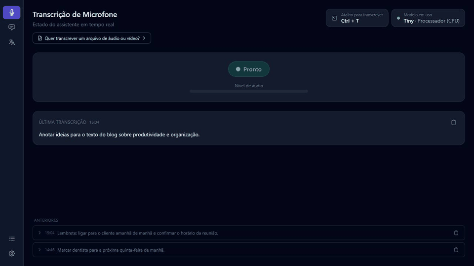</a></td>
    <td width="2%"></td>
    <td align="center"><a href="docs/gifs/arquivo.gif">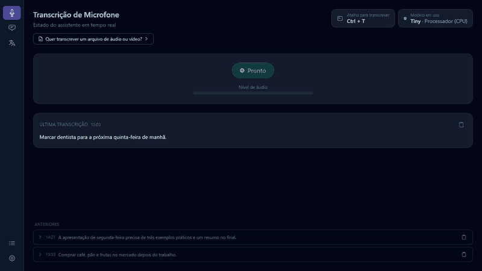</a></td>
  </tr>
  <tr>
    <td width="49%" valign="top" align="center"><b>Tradução offline</b><br/><sub>Português e inglês (e dezenas de outros idiomas) sem internet. O botão do meio inverte a direção.</sub></td>
    <td width="2%"></td>
    <td width="49%" valign="top" align="center"><b>Perguntar por voz</b><br/><sub>Enquanto você segura o atalho da IA, a transcrição vai preenchendo a caixa do chat. Ao soltar, a pergunta é enviada e a resposta já chega falada.</sub></td>
  </tr>
  <tr>
    <td align="center"><a href="docs/gifs/traducao.gif">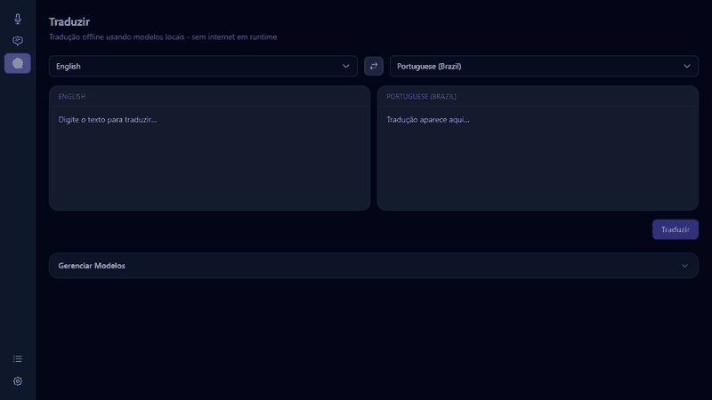</a></td>
    <td width="2%"></td>
    <td align="center"><a href="docs/gifs/voz.gif">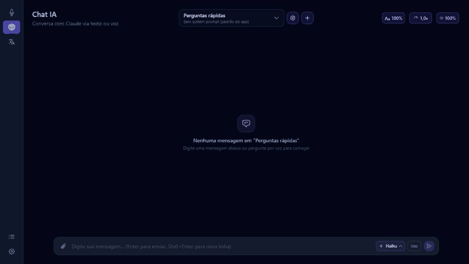</a></td>
  </tr>
  <tr>
    <td width="49%" valign="top" align="center"><b>Chat com imagens</b><br/><sub>A IA mostra imagens quando ajuda. Primeiro uma prévia, depois outra IA confere cada imagem e escreve a legenda em português.</sub></td>
    <td width="2%"></td>
    <td width="49%" valign="top" align="center"><b>Chat com vídeos</b><br/><sub>O mesmo para vídeos do YouTube: miniatura, duração, título e canal. O vídeo abre no navegador.</sub></td>
  </tr>
  <tr>
    <td align="center"><a href="docs/gifs/chat_imagens.gif">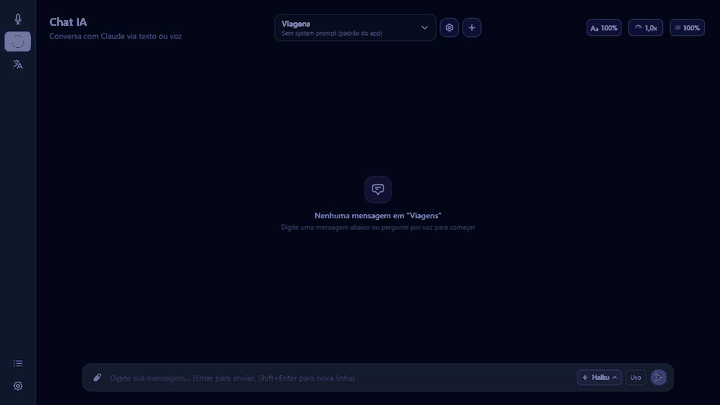</a></td>
    <td width="2%"></td>
    <td align="center"><a href="docs/gifs/chat_videos.gif">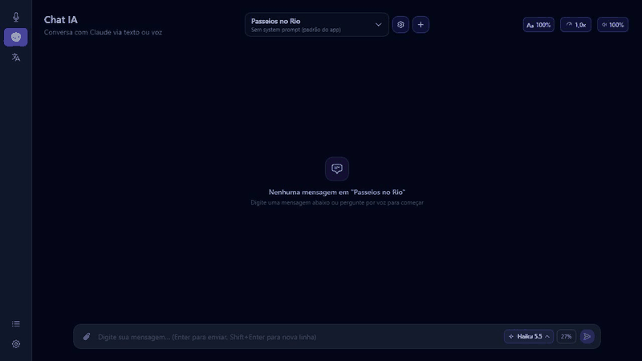</a></td>
  </tr>
  <tr>
    <td width="49%" valign="top" align="center"><b>Repesquisar e refinar por voz</b><br/><sub>Repesquisar busca outras imagens sem repetir. Refinar deixa você descrever por voz o que quer ver (ex.: só fotos à noite).</sub></td>
    <td width="2%"></td>
    <td width="49%" valign="top" align="center"><b>Anexos</b><br/><sub>Anexe imagens ou arquivos de texto e pergunte sobre eles. O limite de tamanho é configurável.</sub></td>
  </tr>
  <tr>
    <td align="center"><a href="docs/gifs/refinar.gif">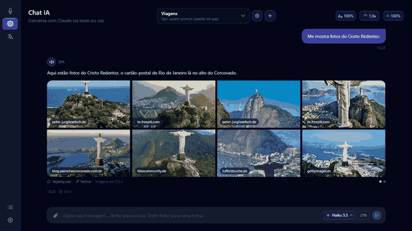</a></td>
    <td width="2%"></td>
    <td align="center"><a href="docs/gifs/anexos.gif">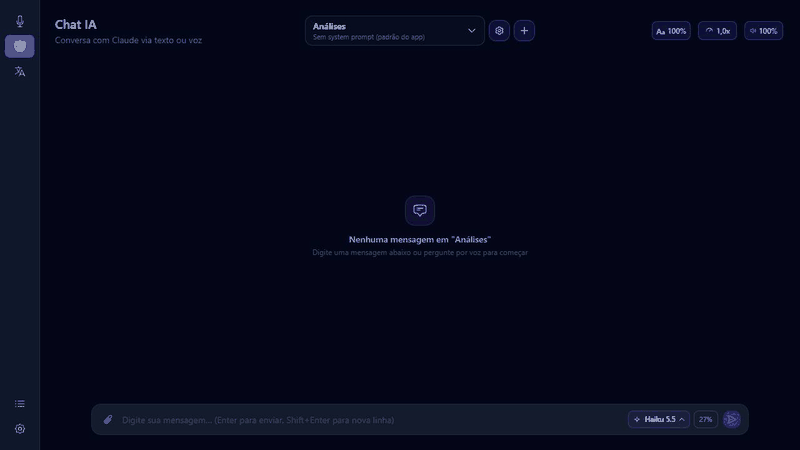</a></td>
  </tr>
  <tr>
    <td width="49%" valign="top" align="center"><b>System prompt criado pela IA</b><br/><sub>Fale o que você quer e a IA escreve o system prompt do chat. Depois é só revisar, pedir ajustes ou salvar.</sub></td>
    <td width="2%"></td>
    <td width="49%" valign="top" align="center"><b>Logs</b><br/><sub>Cada transcrição com origem, modelo, onde rodou, duração e velocidade. Clique numa linha para ler o texto completo.</sub></td>
  </tr>
  <tr>
    <td align="center"><a href="docs/gifs/prompt.gif">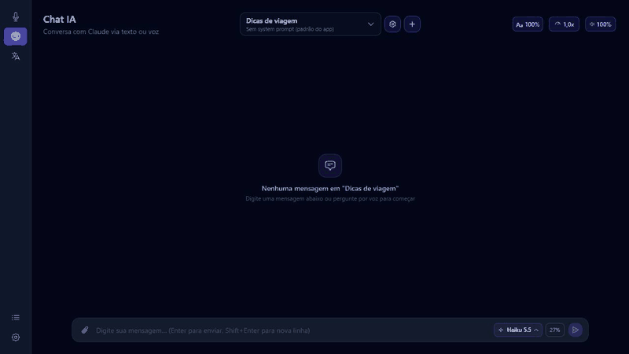</a></td>
    <td width="2%"></td>
    <td align="center"><a href="docs/gifs/logs.gif">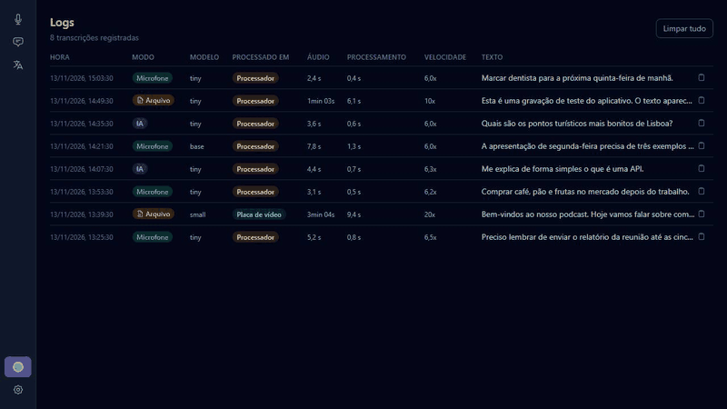</a></td>
  </tr>
  <tr>
    <td width="49%" valign="top" align="center"><b>Configurações</b><br/><sub>Atalhos, modelo do Whisper, voz, sons, modelo do Claude, uso do plano, busca de imagens e armazenamento.</sub></td>
    <td width="2%"></td>
    <td width="49%"></td>
  </tr>
  <tr>
    <td align="center"><a href="docs/gifs/config.gif">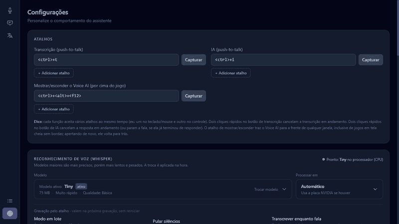</a></td>
    <td width="2%"></td>
    <td align="center"></td>
  </tr>
</table>

---

## Instalação

### Windows (instalador)

1. Execute `Voice AI Setup x.y.z.exe` (cerca de 180 MB).
2. Na primeira abertura, uma tela de configuração baixa o que falta, mostrando o progresso:
   - motor de tradução (~170 MB);
   - modelo Whisper tiny (~75 MB);
   - opcional: bibliotecas CUDA para usar a placa de vídeo NVIDIA (~1,3 GB);
   - opcional: Claude Code, necessário para o Chat IA.
3. Pronto. Os dados ficam em `%APPDATA%\voice-ai`.

Os modelos maiores do Whisper e os idiomas de tradução são baixados depois, dentro do app, quando você quiser.

### A partir do código-fonte

Requisitos: Python 3.11+, Node.js 18+, `ffmpeg`, um microfone. Placa NVIDIA com CUDA é opcional (sem ela o Whisper roda no processador).

```bash
git clone https://github.com/alanazeredoguedes/voice-ai.git
cd voice-ai

# Backend
cd backend
python -m venv venv
# Windows: venv\Scripts\activate    Linux/macOS: source venv/bin/activate
pip install -r requirements.txt
cd ..

# Frontend
cd frontend
npm install
```

### Rodar em desenvolvimento

```bash
./dev.sh        # Linux/macOS
dev.bat         # Windows (ou dev.ps1)
```

Ou manualmente, em dois terminais: `python -m backend.main` (na raiz, com o venv ativo) e `npm run dev` (em `frontend`).

### Gerar o instalador

```powershell
.\build.ps1     # Windows: gera frontend\dist\Voice AI Setup x.y.z.exe
./build.sh      # Linux: AppImage
```

O instalador do Windows leva o Python e as bibliotecas essenciais dentro dele. As partes pesadas (PyTorch/motor de tradução, modelo Whisper, CUDA) são baixadas na primeira execução para manter o instalador pequeno.

---

## Como funciona

```
┌─────────────────────────────────────────────────┐
│                 Electron (frontend)              │
│   Vue 3 + Pinia + Tailwind CSS                   │
│   WebSocket (porta 18450) ←→ HTTP REST           │
└──────────────────┬──────────────────────────────┘
                   │
┌──────────────────▼──────────────────────────────┐
│                FastAPI (backend)                 │
│                                                  │
│  HotkeyManager ──► SpeechEngine (Whisper)        │
│        │               │                         │
│        ▼               ▼                         │
│   Orchestrator ──► ClaudeBrain (streaming)       │
│        │               │                         │
│        │         MediaSearch + MediaJudge        │
│        └──► TextToSpeech (Edge / ElevenLabs)     │
│                                                  │
│            SQLite  (chats, logs)                 │
└─────────────────────────────────────────────────┘
```

**Transcrição pelo atalho:** segure o atalho, o áudio é capturado, ao soltar o Whisper transcreve localmente, o texto vai para a área de transferência e aparece na tela. Com "transcrever enquanto fala" ligado, o texto vai sendo produzido durante a gravação.

**Pergunta para a IA:** segure o atalho da IA e fale. A pergunta é transcrita (e aparece na caixa do chat enquanto você fala), o Claude responde em streaming, cada frase vira áudio em paralelo e começa a tocar assim que fica pronta. A conversa fica salva no chat.

**Imagens e vídeos:** quando a pergunta pede ou quando ajuda a explicar, a IA marca na resposta o que quer mostrar. O app busca (DuckDuckGo, sem chave, ou Google Imagens via Serper, com chave), mostra uma prévia, e um Haiku confere cada resultado e escreve a legenda em português.

---

## Atalhos

| Ação | Padrão | Comportamento |
|------|--------|---------------|
| Transcrever | `Ctrl + T` (segurar) | Grava enquanto pressionado, solta para transcrever |
| Falar com a IA | `Ctrl + I` (segurar) | Igual, mas a pergunta vai para o chat |
| Mostrar/esconder o Voice AI | `Ctrl + Alt + F12` | Traz o app para a frente, até de jogos em tela cheia sem bordas |
| Cancelar | dois cliques rápidos no atalho | Cancela a gravação ou para a resposta da IA |

Os atalhos podem ser teclas, botões do mouse ou combinações, e cada ação aceita mais de um. Configure em **Configurações → Atalhos → Capturar**.

---

## Configurações principais

As configurações ficam em `settings.json` dentro da pasta de dados (`%APPDATA%\voice-ai` no Windows, `~/.local/share/voice-ai` em desenvolvimento no Linux). Quase tudo é ajustável pela própria tela de Configurações.

| Chave | Padrão | Descrição |
|-------|--------|-----------|
| `model` | `tiny` | Modelo do Whisper (`tiny`, `base`, `small`, `medium`, `large-v3`...) |
| `device` | `auto` | `auto`, `cuda` (NVIDIA) ou `cpu` |
| `transcription_key` / `ai_key` | `Ctrl+T` / `Ctrl+I` | Atalhos de transcrição e de IA |
| `whisper_batched` | `true` | Modo em lote: áudios com mais de 30 s são divididos e processados juntos |
| `whisper_stream` | `true` | Transcrever enquanto fala |
| `whisper_vad` | `false` | Pular silêncios |
| `tts_backend` | `edge` | `edge` (gratuito) ou `elevenlabs` (pago) |
| `edge_voice` | `pt-BR-AntonioNeural` | Voz do Edge TTS |
| `claude_model` | `haiku` | Modelo do Claude no chat: `haiku`, `sonnet` ou `opus` |
| `media_enabled` | `true` | Mostrar imagens e vídeos no chat |
| `media_max_images` | `8` | Imagens por busca |
| `media_proactive` | `true` | A IA pode mandar imagens e vídeos por conta própria |
| `web_search` | `true` | A IA pode pesquisar na internet |
| `upload_limit_mb` | `2` | Tamanho máximo de cada anexo do chat |
| `speech_cache_limit_mb` | `20` | Limite de áudios guardados por chat |
| `serper_api_key` | vazio | Chave opcional para busca de imagens pelo Google (Serper) |
| `elevenlabs_api_key` | vazio | Chave opcional da ElevenLabs |

### Modelos do Whisper

Baixados dentro do app, em **Configurações → Reconhecimento de voz**.

| Modelo | Tamanho | Velocidade | Qualidade |
|--------|---------|-----------|-----------|
| `tiny` | ~75 MB | muito rápido | básica |
| `base` | ~145 MB | muito rápido | boa |
| `small` | ~460 MB | rápido | boa |
| `medium` | ~1,5 GB | médio | muito boa |
| `large-v3` | ~3 GB | lento | excelente |

Em dúvida sobre qual usar, o botão **Testar desempenho** compara os modelos no seu computador.

### Voz (TTS)

- **Edge TTS** (padrão, gratuito): vozes neurais da Microsoft, precisa de internet.
- **ElevenLabs** (pago): crie a chave em elevenlabs.io, cole em **Configurações → Síntese de voz** e escolha a voz.

---

## Estrutura do projeto

```
voice-ai/
├── backend/
│   ├── main.py                # FastAPI + WebSocket
│   ├── orchestrator.py        # Coordena Whisper, Claude, TTS e atalhos
│   ├── routes/                # chat, media, transcribe, translate, models, settings, logs...
│   ├── services/
│   │   ├── brain.py           # Claude (streaming)
│   │   ├── speech_engine.py   # faster-whisper + captura de áudio
│   │   ├── tts.py             # Edge TTS / ElevenLabs
│   │   ├── media_search.py    # busca de imagens e vídeos
│   │   ├── media_judge.py     # conferência e legendas das imagens
│   │   ├── prompt_gen.py      # system prompt criado pela IA
│   │   └── hotkey_manager.py  # atalhos de teclado, mouse e controle
│   └── requirements*.txt
├── frontend/
│   ├── src/main/              # processo principal do Electron (instalação, backend)
│   ├── src/renderer/src/      # views, stores (Pinia), componentes, API
│   └── electron-builder.yml
├── tools/                     # utilitários de build
├── build.ps1 / build.sh       # geram o instalador
├── dev.ps1 / dev.sh           # rodam em desenvolvimento
└── docs/gifs/                 # GIFs deste README
```

---

## Solução de problemas

- **O Chat IA não responde:** o Claude Code precisa estar instalado e com login feito. A tela de configuração inicial instala; o login é feito uma vez.
- **Transcrição lenta:** use um modelo menor ou ative a placa NVIDIA (CUDA) em **Configurações → Processar em**.
- **Traduzir pede para instalar idiomas:** é esperado, cada par de idiomas é baixado uma vez.
- **Porta ocupada:** o app usa a porta `18450`; feche outra instância do Voice AI.

---

## Roadmap

- [x] Build para Windows com instalador e configuração inicial
- [x] Download de modelos do Whisper dentro do app
- [ ] Suporte a GPU AMD (ROCm)
- [ ] Ícone próprio do aplicativo
