# Voice AI

[Português](README.md) | [English](README.en.md)

Assistente de voz para desktop: transcreve o que você fala, conversa com a IA (por texto ou por voz), mostra imagens e vídeos nas respostas, traduz textos e documentos inteiros (PDF, Word, PowerPoint...) mantendo o layout, e faz chamadas de voz com compartilhamento de tela direto entre os participantes. Quase tudo roda no seu próprio computador.

**Stack:** Electron + Vue 3 · FastAPI (Python) · Whisper (faster-whisper) · Claude · Edge TTS / ElevenLabs · Argos Translate · PyMuPDF · WebRTC + Cloudflare Tunnel

> Os GIFs abaixo foram gravados com dados fictícios.

---

## O que ele faz

| Aba | O que faz |
|-----|-----------|
| Transcrição de Microfone | Segure o atalho, fale, solte: o texto é transcrito pelo Whisper local e copiado para a área de transferência |
| Transcrever Arquivo | Escolha ou arraste um áudio ou vídeo e receba a transcrição completa |
| Chat IA | Conversa com o Claude por texto ou voz, com respostas faladas, imagens, vídeos e anexos |
| Traduzir | Tradução offline de textos e de arquivos (PDF, DOCX, PPTX, XLSX, TXT, MD, SRT), mantendo o layout do original |
| Chamada | Salas de voz com compartilhamento de tela (com som), chat e envio de arquivos, tudo direto entre os participantes (P2P) |
| Logs | Histórico de todas as transcrições, com modelo, dispositivo e velocidade |
| Configurações | Atalhos, modelos do Whisper, voz, Claude, imagens e armazenamento |

---

## Funcionalidades em ação

<table>
  <tr>
    <td width="49%" valign="top" align="center"><b>Transcrição de Microfone</b><br/><sub>Estado em tempo real, nível do áudio, progresso, a última transcrição e as duas anteriores. O atalho atual aparece no topo.</sub></td>
    <td width="2%"></td>
    <td width="49%" valign="top" align="center"><b>Transcrever arquivo</b><br/><sub>MP3, OGG, WAV, M4A, vídeos e mais, com progresso, duração, tempo de processamento e o texto completo. Tudo local.</sub></td>
  </tr>
  <tr>
    <td align="center"><a href="docs/gifs/microfone.gif">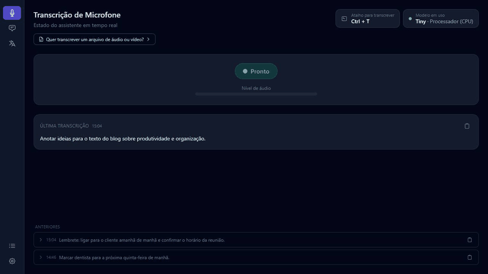</a></td>
    <td width="2%"></td>
    <td align="center"><a href="docs/gifs/arquivo.gif">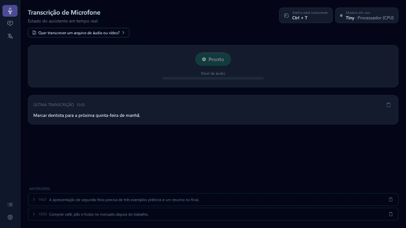</a></td>
  </tr>
  <tr>
    <td width="49%" valign="top" align="center"><b>Tradução offline</b><br/><sub>Português e inglês (e dezenas de outros idiomas) sem internet. O botão do meio inverte a direção.</sub></td>
    <td width="2%"></td>
    <td width="49%" valign="top" align="center"><b>Perguntar por voz</b><br/><sub>Enquanto você segura o atalho da IA, a transcrição vai preenchendo a caixa do chat. Ao soltar, a pergunta é enviada e a resposta já chega falada.</sub></td>
  </tr>
  <tr>
    <td align="center"><a href="docs/gifs/traducao.gif">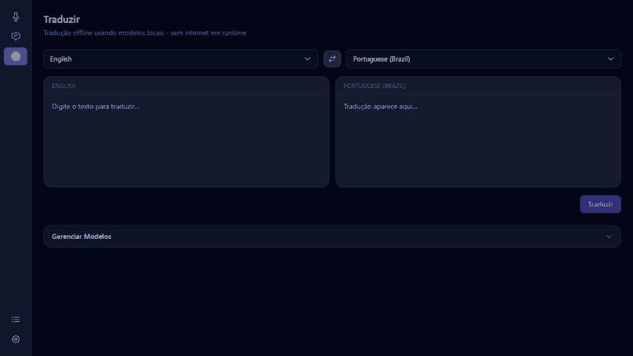</a></td>
    <td width="2%"></td>
    <td align="center"><a href="docs/gifs/voz.gif">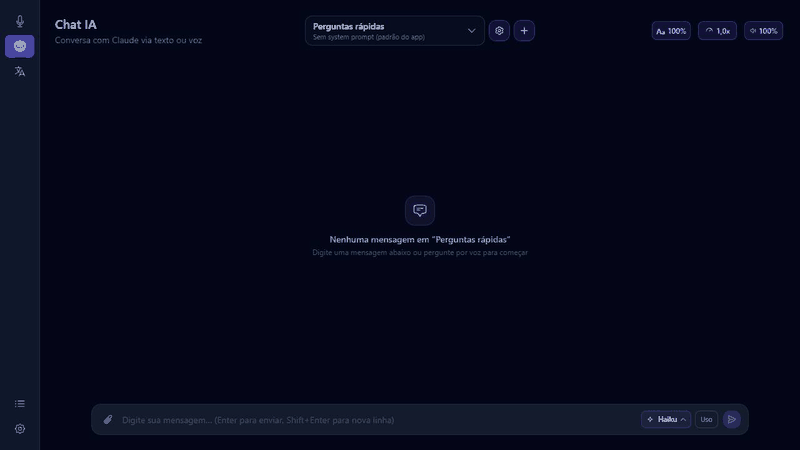</a></td>
  </tr>
  <tr>
    <td width="49%" valign="top" align="center"><b>Chat com imagens</b><br/><sub>A IA mostra imagens quando ajuda. Primeiro uma prévia, depois outra IA confere cada imagem e escreve a legenda em português.</sub></td>
    <td width="2%"></td>
    <td width="49%" valign="top" align="center"><b>Chat com vídeos</b><br/><sub>O mesmo para vídeos do YouTube: miniatura, duração, título e canal. O vídeo abre no navegador.</sub></td>
  </tr>
  <tr>
    <td align="center"><a href="docs/gifs/chat_imagens.gif">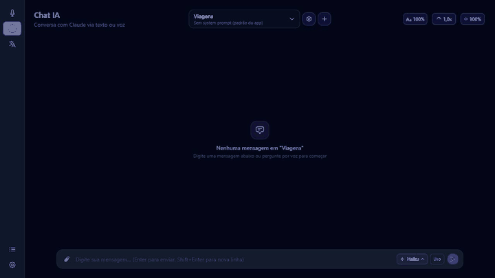</a></td>
    <td width="2%"></td>
    <td align="center"><a href="docs/gifs/chat_videos.gif">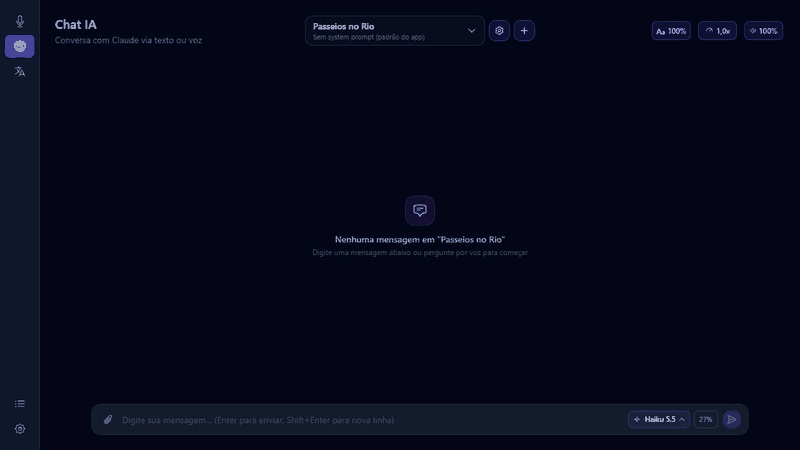</a></td>
  </tr>
  <tr>
    <td width="49%" valign="top" align="center"><b>Repesquisar e refinar por voz</b><br/><sub>Repesquisar busca outras imagens sem repetir. Refinar deixa você descrever por voz o que quer ver (ex.: só fotos à noite).</sub></td>
    <td width="2%"></td>
    <td width="49%" valign="top" align="center"><b>Anexos</b><br/><sub>Anexe imagens ou arquivos de texto e pergunte sobre eles. O limite de tamanho é configurável.</sub></td>
  </tr>
  <tr>
    <td align="center"><a href="docs/gifs/refinar.gif">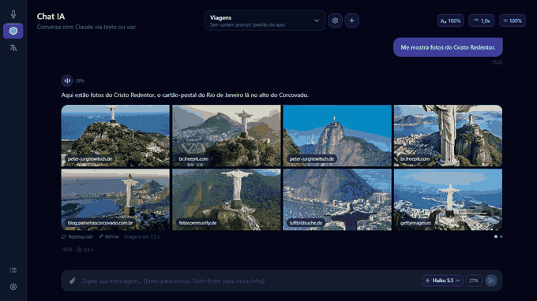</a></td>
    <td width="2%"></td>
    <td align="center"><a href="docs/gifs/anexos.gif">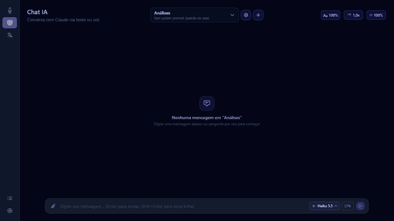</a></td>
  </tr>
  <tr>
    <td width="49%" valign="top" align="center"><b>System prompt criado pela IA</b><br/><sub>Fale o que você quer e a IA escreve o system prompt do chat. Depois é só revisar, pedir ajustes ou salvar.</sub></td>
    <td width="2%"></td>
    <td width="49%" valign="top" align="center"><b>Logs</b><br/><sub>Cada transcrição com origem, modelo, onde rodou, duração e velocidade. Clique numa linha para ler o texto completo.</sub></td>
  </tr>
  <tr>
    <td align="center"><a href="docs/gifs/prompt.gif">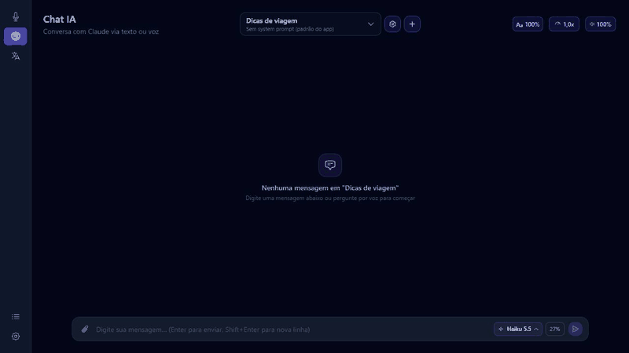</a></td>
    <td width="2%"></td>
    <td align="center"><a href="docs/gifs/logs.gif">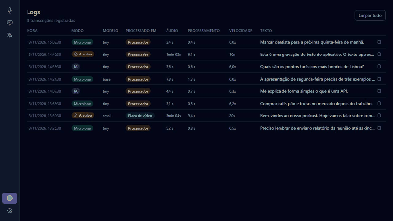</a></td>
  </tr>
  <tr>
    <td width="49%" valign="top" align="center"><b>Configurações</b><br/><sub>Atalhos, modelo do Whisper, voz, sons, modelo do Claude, uso do plano, busca de imagens e armazenamento.</sub></td>
    <td width="2%"></td>
    <td width="49%"></td>
  </tr>
  <tr>
    <td align="center"><a href="docs/gifs/config.gif">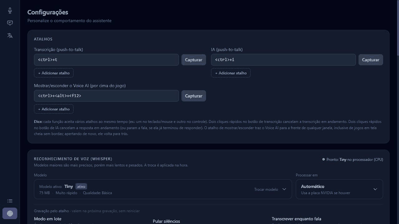</a></td>
    <td width="2%"></td>
    <td align="center"></td>
  </tr>
</table>

---

## Instalação

Baixe a versão mais recente em [Releases](https://github.com/alanazeredoguedes/voice-ai/releases): o `.exe` para Windows ou o `.AppImage` para Linux.

### Windows (instalador)

1. Execute `Voice AI Setup x.y.z.exe` (cerca de 180 MB).
2. Na primeira abertura, uma tela pede confirmação e baixa o que falta, mostrando o progresso:
   - motor de tradução e componentes da tradução de arquivos (PyMuPDF, lxml);
   - modelo Whisper tiny (~75 MB);
   - `cloudflared`, usado para criar salas na aba Chamada (~40 MB);
   - opcional: bibliotecas CUDA para usar a placa de vídeo NVIDIA (~1,3 GB);
   - opcional: Claude Code, necessário para o Chat IA.
3. Pronto. Os dados ficam em `%APPDATA%\voice-ai`.

### Linux (AppImage)

```bash
chmod +x Voice.AI-x.y.z.AppImage
./Voice.AI-x.y.z.AppImage
```

Na primeira abertura, a mesma tela de configuração baixa os componentes em Python (no Linux eles não vão dentro do AppImage, então o download é maior) e o resto da lista acima. Os dados ficam em `~/.config/voice-ai`.

Em **Configurações → Geral** dá para **iniciar com o sistema** (Windows e Linux). Quando uma versão nova do app precisa de componentes novos, ele pede para atualizar na abertura e baixa só o que falta.

Os modelos maiores do Whisper e os idiomas de tradução são baixados depois, dentro do app, quando você quiser.

### A partir do código-fonte

Requisitos: Python 3.11+, Node.js 18+, `ffmpeg`, um microfone. Placa NVIDIA com CUDA é opcional (sem ela o Whisper roda no processador).

```bash
git clone https://github.com/alanazeredoguedes/voice-ai.git
cd voice-ai

# Backend
cd backend
python -m venv venv
# Windows: venv\Scripts\activate    Linux/macOS: source venv/bin/activate
pip install -r requirements.txt
cd ..

# Frontend
cd frontend
npm install
```

### Rodar em desenvolvimento

```bash
./dev.sh        # Linux/macOS
dev.bat         # Windows (ou dev.ps1)
```

Ou manualmente, em dois terminais: `python -m backend.main` (na raiz, com o venv ativo) e `npm run dev` (em `frontend`).

O modo de desenvolvimento é **isolado do app instalado**: usa a porta `18451` (o instalado usa `18450`) e pastas próprias (`~/.config/voice-ai-dev` para o Electron e `~/.local/share/voice-ai` para o backend, com modelos do Whisper e pacotes de tradução separados). Dá para rodar os dois ao mesmo tempo, e apagar um não afeta o outro. O backend não recarrega sozinho: depois de mudar código Python, rode o `dev.sh` de novo.

### Gerar o instalador

```powershell
.\build.ps1     # Windows: gera frontend\dist\Voice AI Setup x.y.z.exe
./build.sh      # Linux: AppImage
```

O instalador do Windows leva o Python e as bibliotecas essenciais dentro dele. As partes pesadas (PyTorch/motor de tradução, tradução de arquivos, modelo Whisper, CUDA, cloudflared) são baixadas na primeira execução para manter o instalador pequeno. O AppImage leva o Python; as bibliotecas são baixadas na primeira execução.

---

## Como funciona

```
┌─────────────────────────────────────────────────┐
│                 Electron (frontend)              │
│   Vue 3 + Pinia + Tailwind CSS                   │
│   WebSocket (porta 18450) ←→ HTTP REST           │
│   Chamada: WebRTC (P2P) + sinalização/túnel      │
└──────────────────┬──────────────────────────────┘
                   │
┌──────────────────▼──────────────────────────────┐
│                FastAPI (backend)                 │
│                                                  │
│  HotkeyManager ──► SpeechEngine (Whisper)        │
│        │               │                         │
│        ▼               ▼                         │
│   Orchestrator ──► ClaudeBrain (streaming)       │
│        │               │                         │
│        │         MediaSearch + MediaJudge        │
│        └──► TextToSpeech (Edge / ElevenLabs)     │
│                                                  │
│  Tradução: Argos (texto) + PyMuPDF / lxml        │
│            (PDF, Word, PowerPoint, Excel)        │
│                                                  │
│            SQLite  (chats, logs)                 │
└─────────────────────────────────────────────────┘
```

Cada aba está explicada em detalhe em [Funcionalidades](#funcionalidades). Em resumo: o Electron mostra a interface e conversa com o backend em Python (FastAPI) pela porta local; o backend cuida do Whisper, do Claude, da voz e da tradução. A Chamada é a exceção: a rede dela fica toda no Electron e o backend não participa.

---

## Atalhos

| Ação | Padrão | Comportamento |
|------|--------|---------------|
| Transcrever | `Ctrl + T` (segurar) | Grava enquanto pressionado, solta para transcrever |
| Falar com a IA | `Ctrl + I` (segurar) | Igual, mas a pergunta vai para o chat |
| Mostrar/esconder o Voice AI | `Ctrl + Alt + F12` | Traz o app para a frente, até de jogos em tela cheia sem bordas (opção "manter sempre na frente" ao lado do atalho) |
| Cancelar | dois cliques rápidos no atalho | Cancela a gravação ou para a resposta da IA |

Os atalhos podem ser teclas, botões do mouse ou combinações, e cada ação aceita mais de um. Configure em **Configurações → Atalhos → Capturar**.

---

## Configurações principais

As configurações ficam em `settings.json` dentro da pasta de dados (`%APPDATA%\voice-ai` no Windows, `~/.config/voice-ai` no AppImage, `~/.local/share/voice-ai` em desenvolvimento). Quase tudo é ajustável pela própria tela de Configurações.

| Chave | Padrão | Descrição |
|-------|--------|-----------|
| `model` | `tiny` | Modelo do Whisper (`tiny`, `base`, `small`, `medium`, `large-v3`...) |
| `device` | `auto` | `auto`, `cuda` (NVIDIA) ou `cpu` |
| `transcription_key` / `ai_key` | `Ctrl+T` / `Ctrl+I` | Atalhos de transcrição e de IA |
| `whisper_batched` | `true` | Modo em lote: áudios com mais de 30 s são divididos e processados juntos |
| `whisper_stream` | `true` | Transcrever enquanto fala |
| `whisper_vad` | `false` | Pular silêncios |
| `tts_backend` | `edge` | `edge` (gratuito) ou `elevenlabs` (pago) |
| `edge_voice` | `pt-BR-AntonioNeural` | Voz do Edge TTS |
| `claude_model` | `sonnet` | Modelo do Claude no chat: `haiku`, `sonnet` ou `opus` |
| `window_keep_on_top` | `false` | O atalho de mostrar deixa a janela sempre na frente |
| `media_enabled` | `true` | Mostrar imagens e vídeos no chat |
| `media_max_images` | `8` | Imagens por busca |
| `media_proactive` | `true` | A IA pode mandar imagens e vídeos por conta própria |
| `web_search` | `true` | A IA pode pesquisar na internet |
| `upload_limit_mb` | `2` | Tamanho máximo de cada anexo do chat |
| `speech_cache_limit_mb` | `20` | Limite de áudios guardados por chat |
| `serper_api_key` | vazio | Chave opcional para busca de imagens pelo Google (Serper) |
| `elevenlabs_api_key` | vazio | Chave opcional da ElevenLabs |

### Modelos do Whisper

Baixados dentro do app, em **Configurações → Reconhecimento de voz**.

| Modelo | Tamanho | Velocidade | Qualidade |
|--------|---------|-----------|-----------|
| `tiny` | ~75 MB | muito rápido | básica |
| `base` | ~145 MB | muito rápido | boa |
| `small` | ~460 MB | rápido | boa |
| `medium` | ~1,5 GB | médio | muito boa |
| `large-v3` | ~3 GB | lento | excelente |

Em dúvida sobre qual usar, o botão **Testar desempenho** compara os modelos no seu computador.

### Voz (TTS)

- **Edge TTS** (padrão, gratuito): vozes neurais da Microsoft, precisa de internet.
- **ElevenLabs** (pago): crie a chave em elevenlabs.io, cole em **Configurações → Síntese de voz** e escolha a voz.

---

## Estrutura do projeto

```
voice-ai/
├── backend/
│   ├── main.py                # FastAPI + WebSocket
│   ├── orchestrator.py        # Coordena Whisper, Claude, TTS e atalhos
│   ├── routes/                # chat, media, transcribe, translate, translate_files, models, storage...
│   ├── services/
│   │   ├── brain.py           # Claude (streaming)
│   │   ├── file_translate.py  # tradução de PDF/Office/texto mantendo o layout, tema escuro do PDF
│   │   ├── speech_engine.py   # faster-whisper + captura de áudio
│   │   ├── tts.py             # Edge TTS / ElevenLabs
│   │   ├── media_search.py    # busca de imagens e vídeos
│   │   ├── media_judge.py     # conferência e legendas das imagens
│   │   ├── prompt_gen.py      # system prompt criado pela IA
│   │   └── hotkey_manager.py  # atalhos de teclado, mouse e controle
│   └── requirements*.txt
├── frontend/
│   ├── src/main/              # processo principal do Electron (instalação, backend)
│   │   ├── call.ts            # Chamada: sinalização, túnel (cloudflared), histórico das salas
│   │   ├── callRendezvous.ts  # ponto de encontro das salas (ntfy.sh, criptografado)
│   │   └── linuxShareAudio.ts # som da transmissão no Linux (PipeWire)
│   ├── src/renderer/src/      # views, stores (Pinia), componentes, API
│   │   └── composables/useCallRtc.ts  # WebRTC em malha (voz, tela, chat, arquivos)
│   ├── scripts/release.mjs    # npm run release
│   └── electron-builder.yml
├── .github/workflows/         # release automática (AppImage + .exe)
├── tools/                     # utilitários de build
├── build.ps1 / build.sh       # geram o instalador
├── dev.ps1 / dev.sh           # rodam em desenvolvimento
└── docs/gifs/                 # GIFs deste README
```

---

## Publicar uma versão

Com tudo commitado e enviado para a `main`, dentro de `frontend`:

```bash
npm run release              # 1.1.0 -> 1.1.1 (correção)
npm run release -- minor     # 1.1.0 -> 1.2.0 (novidade)
npm run release -- 1.4.0     # versão exata
```

O script confere o código, sobe a versão e envia a tag `vX.Y.Z`. A GitHub então gera o `.AppImage` (Linux) e o `.exe` (Windows) e publica os dois em **Releases** (uns 10 minutos; acompanhe na aba **Actions**).

---

## Funcionalidades

Uma seção para cada aba do app: o que ela faz e como funciona por dentro.

- [Transcrição de Microfone](#transcrição-de-microfone)
- [Transcrever Arquivo](#transcrever-arquivo)
- [Chat IA](#chat-ia)
- [Traduzir](#traduzir)
- [Chamada](#chamada)
- [Logs](#logs)
- [Configurações e armazenamento](#configurações-e-armazenamento)

### Transcrição de Microfone

Segure o atalho (`Ctrl + T` por padrão), fale e solte. O áudio é capturado enquanto o atalho está pressionado e, ao soltar, o **Whisper transcreve no seu computador** (o áudio não vai para nenhum servidor). O texto vai para a área de transferência, pronto para colar, e aparece na tela junto com as duas transcrições anteriores.

- **Transcrever enquanto fala** (`whisper_stream`): o texto vai sendo produzido durante a gravação, então ao soltar ele já está quase pronto.
- **Modo em lote** (`whisper_batched`): áudios com mais de 30 s são divididos em partes processadas juntas, o que acelera as gravações longas.
- **Pular silêncios** (`whisper_vad`): desligado por padrão.
- **Cancelar:** dois cliques rápidos no atalho descartam a gravação.
- A tela mostra o estado em tempo real (ouvindo, transcrevendo), o nível do áudio e o progresso.

Roda na placa de vídeo NVIDIA (CUDA) quando há uma, ou no processador. O modelo do Whisper é escolhido em **Configurações** (veja [Modelos do Whisper](#modelos-do-whisper)).

### Transcrever Arquivo

Escolha ou arraste um áudio ou vídeo (MP3, OGG, WAV, M4A, MP4 e outros formatos que o `ffmpeg` lê) e receba a transcrição completa, com progresso, duração do áudio e tempo de processamento. Também é tudo local, com o mesmo modelo do Whisper da transcrição pelo microfone.

### Chat IA

Conversa com o **Claude** (pelo Claude Code instalado no computador) por texto ou por voz, com as conversas salvas no app.

- **Perguntar por voz:** segure o atalho da IA (`Ctrl + I`) e fale. Enquanto você fala, a transcrição vai preenchendo a caixa do chat; ao soltar, a pergunta é enviada. O Claude responde em streaming, cada frase vira áudio em paralelo e começa a tocar assim que fica pronta.
- **Respostas faladas:** pelo Edge TTS (gratuito) ou pela ElevenLabs (paga). Veja [Voz (TTS)](#voz-tts).
- **Imagens e vídeos nas respostas:** quando a pergunta pede ou quando ajuda a explicar, a IA marca na resposta o que quer mostrar. O app busca (DuckDuckGo, sem chave, ou Google Imagens via Serper, com chave), mostra uma prévia, e um Haiku confere cada resultado e escreve a legenda em português. Vídeos do YouTube aparecem com miniatura, duração, título e canal.
- **Repesquisar e refinar:** repesquisar busca outras imagens sem repetir; refinar deixa você descrever por voz o que quer ver.
- **Anexos:** imagens e arquivos de texto, com limite de tamanho configurável.
- **Pesquisa na internet:** a IA pode pesquisar quando precisa de informação atual (`web_search`).
- **System prompt criado pela IA:** fale o que você quer e a IA escreve o system prompt do chat; depois é só revisar, pedir ajustes ou salvar.
- **Modelo:** Haiku, Sonnet (padrão) ou Opus, com o uso do plano visível nas configurações.

### Traduzir

Tradução **offline** com o Argos Translate: os pacotes de idioma são baixados uma vez, dentro do app, e depois funcionam sem internet. A aba tem duas partes: **Texto** e **Arquivos**.

#### Texto

Digite ou cole um texto e escolha os idiomas; o botão do meio inverte a direção. Funciona com português, inglês e dezenas de outros idiomas. Para português brasileiro, instale o par **Inglês → Português (Brasil)**, que evita palavras de Portugal ("projecto", "equipa").

#### Arquivos (PDF, Word, PowerPoint, Excel, texto e legendas)

Na aba **Traduzir → Arquivos**, arraste um ou mais arquivos (ou clique para escolher). Cada um é traduzido no seu computador, sem internet, com os mesmos pacotes de idioma da tradução de texto. A fila mostra o progresso (no PDF, página por página).

| Formato | Como é traduzido | Resultado |
|---------|------------------|-----------|
| **PDF** | o texto é reescrito em cima da página original (detalhes abaixo) | muito parecido com o original |
| **Word (DOCX)** | só o texto é trocado dentro do arquivo: parágrafos, tabelas, cabeçalhos, rodapés, notas, caixas de texto e gráficos | praticamente idêntico |
| **PowerPoint (PPTX)** | slides, anotações, SmartArt e gráficos | praticamente idêntico |
| **Excel (XLSX)** | células de texto (fórmulas e números ficam como estão) | idêntico |
| **TXT, Markdown, SRT** | parágrafo a parágrafo; no Markdown, títulos, listas e tabelas mantêm a marcação e blocos de código não são traduzidos; na legenda, números e tempos ficam | idêntico |

##### Como o PDF mantém o layout

O PDF não guarda parágrafos, só pedaços de texto em posições fixas na página. Para cada página, o app:

1. **lê os blocos de texto** com posição, fonte, tamanho, cor, negrito e itálico, e junta as linhas em parágrafos (respeitando listas, numeração, colunas e células de tabela);
2. **traduz cada parágrafo inteiro** (o modelo entende melhor a frase completa do que linhas soltas). Numeração ("1.", "a)") e marcadores de lista ficam fora da tradução, e rótulos em destaque no começo do parágrafo ("**Nota:**") são traduzidos à parte para manter o destaque;
3. **apaga só o texto original** da página: imagens, linhas, fundos e tabelas desenhadas continuam lá;
4. **escreve a tradução na mesma caixa**, com o mesmo tamanho, cor, alinhamento e altura da linha. Se o texto traduzido for maior (do inglês para o português costuma crescer 15 a 30%), ele usa o espaço livre ao lado e abaixo e, se ainda não couber, a fonte diminui um pouco.

A fonte é escolhida nesta ordem: a **própria fonte embutida no PDF** (quando ela tem todas as letras da tradução; os PDFs costumam levar só as letras usadas no original, então em inglês faltam "ç", "ã", "é"...); depois a **mesma fonte instalada no computador** ou uma de mesmas medidas (Arial ↔ Liberation Sans, Times ↔ Liberation Serif, Calibri ↔ Carlito...); por último uma fonte parecida (serifada, sem serifa ou monoespaçada).

##### Pré-visualizar, tema e salvar

Cada PDF traduzido tem três ações:

- **Claro | Escuro**: o tema do arquivo. O escuro deixa o fundo escuro e o texto claro **mantendo as cores** (um título azul continua azul, só que claro); fotos e imagens ficam como no original e o texto continua selecionável. É gerado na hora, depois da tradução, e vale para pré-visualizar e salvar.
- **Pré-visualizar**: abre o original e a tradução lado a lado (ou um de cada vez). Abre com a página inteira na tela e tem zoom (botões, `Ctrl` + roda do mouse, `+`/`-`), girar (`R`), arrastar para mover, troca de tema (`T`), setas ou lista de páginas com busca pelo número, e o botão **Salvar**. As páginas são desenhadas na resolução da sua tela; primeiro aparece uma versão leve e logo depois a nítida, e a próxima página já fica pronta em segundo plano.
- **Salvar**: escolha a pasta e salve o arquivo no tema escolhido.

Os arquivos ficam numa pasta temporária do app até você salvar; o **X** do item apaga essa cópia (o que você salvou continua). O espaço usado aparece em **Configurações → Armazenamento**.

**Limitações:** PDFs digitalizados (fotos de páginas) e texto dentro de imagens não são traduzidos; dentro de um mesmo parágrafo prevalece o estilo principal (uma palavra em negrito no meio da frase perde o negrito); o tema escuro vale só para PDF. A qualidade é a do Argos Translate (veja a dica do par Português (Brasil) em [Texto](#texto)).

### Chamada

Salas de voz para conversar, assistir à tela de alguém e trocar mensagens e arquivos, **sem servidor próprio, sem conta e sem abrir portas no roteador**.

**O que tem na sala:**

- **Voz** com escolha de microfone e saída de som, medidor de quem está falando e, pelo botão direito em cada pessoa, volume individual (0 a 400%, com mais precisão nos volumes baixos) e "silenciar para mim".
- **Compartilhamento de tela** (tela inteira ou uma janela) de 480p a 4K, com taxa de quadros ajustável e **som do computador**. Mais de uma pessoa pode transmitir ao mesmo tempo; quem assiste pode ampliar, dar zoom, arrastar, colocar em tela cheia ou minimizar no canto.
- **Chat** com edição e exclusão para todos, e **arquivos de até 500 MB** (imagens e vídeos com prévia; dá para colar ou arrastar).
- **Histórico guardado no seu computador**: quem entra recebe as últimas 500 mensagens de quem já está na sala, e um arquivo antigo pode ser pedido a quem tem uma cópia.
- **Salas anteriores ao vivo**: a lista mostra quais salas estão abertas agora e quem está nelas. **Reabrir** entra na sala que já está aberta (em vez de cada um abrir a sua); se ninguém estiver com ela aberta, você passa a hospedá-la. Se duas pessoas clicarem juntas, quem reservou primeiro abre e a outra vê "Aguarde: Fulano está abrindo a sala" e entra junto.
- **Microfone ajustável** (botão de ajustes ao lado de **Logs**): volume do microfone, **só transmitir quando eu falar** (com medidor ao vivo e limite ajustável) e, no Linux, **tirar do microfone o som do computador**: um processo do PipeWire do próprio app roda o cancelamento de eco do WebRTC usando como referência tudo o que sai na caixa de som (quem assiste a um vídeo na caixa de som não manda esse som de volta pelo microfone). Não instala nada: o módulo vem no PipeWire, o servidor de som padrão do Ubuntu desde a 22.10.
- **Controle de entrada**: quem chega pela primeira vez fica esperando até alguém de dentro clicar em **Aceitar** (ou **Recusar**, e a pessoa vê o aviso). Quem já participou da sala entra direto.
- **Logs da sala** (botão **Logs**): tudo o que acontece na chamada (conexões, rota da rede, microfone, transmissão, volumes, arquivos, erros), os seus e os dos outros participantes juntos, com filtro e botão **Copiar**. A cada 30 s entra um resumo das conexões (taxa, perda de pacotes e nível do som).

#### Como funciona a rede

```
  Quem cria a sala                                        Convidados
┌──────────────────────┐                              ┌───────────────┐
│ Servidor de          │◄── túnel da Cloudflare ─────►│ entram com o  │
│ sinalização (local)  │    (código da sala =         │ código        │
└──────────────────────┘     endereço do túnel)       └───────────────┘
          ▲   só o "aperto de mão" (SDP / ICE) passa por aqui
          ▼
┌──────────────────────────────────────────────────────────────────────┐
│ WebRTC em malha: cada participante conecta DIRETO com cada um dos      │
│ outros. Voz, tela, chat e arquivos vão de pessoa para pessoa,          │
│ criptografados (DTLS-SRTP), sem passar por nenhum servidor.            │
└──────────────────────────────────────────────────────────────────────┘
```

1. **Criar a sala:** o app sobe um servidor de sinalização mínimo (um WebSocket só em `127.0.0.1`) e abre um **quick tunnel da Cloudflare** (`cloudflared`, baixado na instalação) que dá a ele um endereço público temporário. O nome aleatório do túnel (ex.: `calm-river-paper-moon`) é o **código da sala**. O código só aparece quando o endereço já funciona para quem está de fora (o app espera o nome existir nos servidores DNS da Cloudflare).
2. **Entrar:** o convidado digita o código e se conecta à sinalização pelo túnel. Por ali passam só as mensagens de negociação do WebRTC (SDP e candidatos ICE), **nunca áudio, vídeo, chat ou arquivos**.
3. **Conexão direta:** com servidores STUN públicos (Google e Cloudflare), cada participante descobre seu endereço público e o WebRTC abre uma conexão **ponto a ponto** com cada um dos outros (uma malha, ou *mesh*). Cada conexão leva o microfone, o vídeo e o som da tela e canais de dados para o chat e para os arquivos (em pedaços de 64 KB).
4. **Economia de banda:** a tela só é enviada a quem está assistindo; as faixas ficam negociadas, mas desligadas até a pessoa abrir a transmissão. A renegociação segue o padrão *perfect negotiation* (dois participantes podem ligar a tela ao mesmo tempo sem travar).
5. **Ponto de encontro (ntfy.sh):** o código muda toda vez que a sala é aberta, então quem hospeda publica "a sala está no código X" num tópico do [ntfy.sh](https://ntfy.sh). O nome do tópico é um hash do id da sala (que só quem já esteve nela conhece) e o conteúdo vai **criptografado** (AES-256-GCM, com chave derivada do id da sala): o ntfy.sh só vê bytes, e só guarda isso (por 12 h). Quem está na sala, visto de fora, vem do próprio servidor da sala.
6. **Entrada:** o servidor da sala manda uma etiqueta da sala; quem já participou responde com uma prova (derivada do id da sala) e entra direto. Quem não tem a prova fica na fila até alguém de dentro aceitar.
7. **Se quem hospeda sair** (ou o túnel cair), a chamada continua (a conexão é direta) e a sala se reabre sozinha: se quem hospedava ainda está na chamada, ele abre outro túnel; senão, quem ficou com o menor id abre um servidor novo. O código novo vai para os outros pelo canal direto e para o ponto de encontro.

**Som da transmissão:** no Windows é o som do computador inteiro, menos o do próprio Voice AI (para ninguém ouvir a própria voz de volta). No Linux, o app cria um microfone virtual no PipeWire (`VoiceAI-Transmissao`, com `pw-cli`) e liga a ele o som de todos os programas (tela inteira) ou só o do programa da janela escolhida (X11). Antes de enviar, um **ganho automático** sobe o som até um nível bom (nunca abaixa) com um limitador contra distorção: mesmo que quem transmite esteja ouvindo baixo, o som chega cheio e quem assiste ajusta o volume do seu lado. O som da tela vai a até 128 kbps.

**Captura da tela no Linux com Xorg:** o app copia a tela com o `ffmpeg` (`x11grab`) em vez do capturador do Chromium, que no Xorg fica em ~10 fps em telas grandes (ele se limita a 50% de um núcleo). Com o ffmpeg, 1080p chega a ~58 fps, 2K a ~35 e 4K a ~28 (o limite passa a ser a compressão no processador). Sem ffmpeg, ou se algo falhar, volta sozinho para a captura do Chromium; o motivo aparece em **Logs**. A próxima etapa, comprimir pela placa de vídeo, está em [docs/plano-transmissao-placa-de-video.md](docs/plano-transmissao-placa-de-video.md).

**Limites:** como é uma malha, cada pessoa envia sua voz (e sua tela, para quem assiste) para cada um dos outros, então funciona melhor com grupos pequenos. Não há servidor TURN de retransmissão: em redes muito restritivas (algumas redes corporativas ou NAT simétrico dos dois lados), a conexão direta pode não ser possível.

### Logs

Histórico de todas as transcrições (do microfone e de arquivos), com origem, modelo, onde rodou (placa de vídeo ou processador), duração do áudio e velocidade. Clique numa linha para ler o texto completo.

Os logs das chamadas ficam na própria tela da Chamada, no botão **Logs** (veja [Chamada](#chamada)).

### Configurações e armazenamento

Atalhos, modelo do Whisper (com download dentro do app e um teste de desempenho que compara os modelos no seu computador), voz e sons, modelo do Claude e uso do plano, busca de imagens, iniciar com o sistema e **Armazenamento**, que mostra quanto espaço cada parte usa (modelos, chats, áudios, arquivos traduzidos...) e permite apagar. As chaves do `settings.json` estão em [Configurações principais](#configurações-principais).

---

## Solução de problemas

- **O Chat IA não responde:** o Claude Code precisa estar instalado e com login feito. A tela de configuração inicial instala; o login é feito uma vez.
- **Transcrição lenta:** use um modelo menor ou ative a placa NVIDIA (CUDA) em **Configurações → Processar em**.
- **Traduzir pede para instalar idiomas:** é esperado, cada par de idiomas é baixado uma vez.
- **Porta ocupada:** o app instalado usa a porta `18450` e o modo de desenvolvimento a `18451`; feche a outra instância do Voice AI.
- **O código da sala demora a aparecer:** é esperado (alguns segundos); ele só aparece quando já funciona para os convidados.
- **Não consigo conectar com alguém na chamada:** sem servidor TURN, redes muito restritivas (algumas redes corporativas) podem bloquear a conexão direta. Teste em outra rede.
- **Sem som da transmissão no Linux:** o compartilhamento de som usa o PipeWire (`pw-cli`, `pw-dump` e `pw-link`, do pacote `pipewire-bin`); em sistemas só com PulseAudio ele não funciona. O motivo aparece em **Logs**.
- **Para depurar uma chamada:** abra **Logs**, reproduza o problema e clique em **Copiar**. As linhas de todos os participantes aparecem juntas.
- **"Não encontrei texto no PDF":** o PDF é digitalizado (fotos das páginas). Ainda não há reconhecimento de texto (OCR).
- **Tradução de arquivos pede para atualizar:** instalações antigas recebem os componentes novos (PyMuPDF, lxml) na próxima abertura.

---

## Roadmap

- [x] Build para Windows com instalador e configuração inicial
- [x] Download de modelos do Whisper dentro do app
- [x] AppImage para Linux e releases automáticas pela GitHub
- [x] Chamada P2P com voz, tela, chat e arquivos
- [x] Tradução de arquivos (PDF, Word, PowerPoint, Excel) mantendo o layout, com tema escuro e pré-visualização
- [ ] OCR para traduzir PDFs digitalizados
- [ ] Servidor TURN opcional para chamadas em redes restritivas
- [ ] Suporte a GPU AMD (ROCm)
- [ ] Ícone próprio do aplicativo
