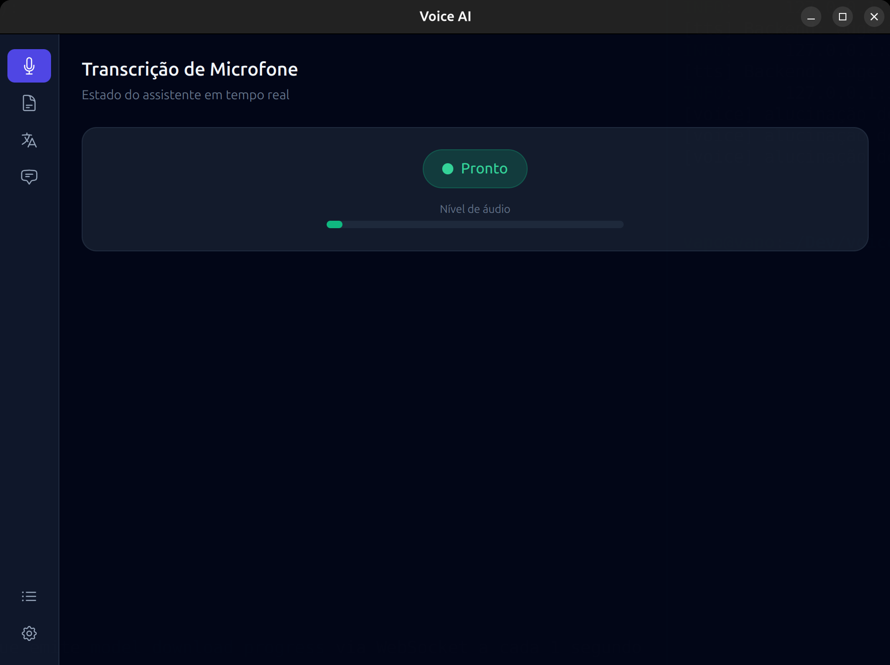
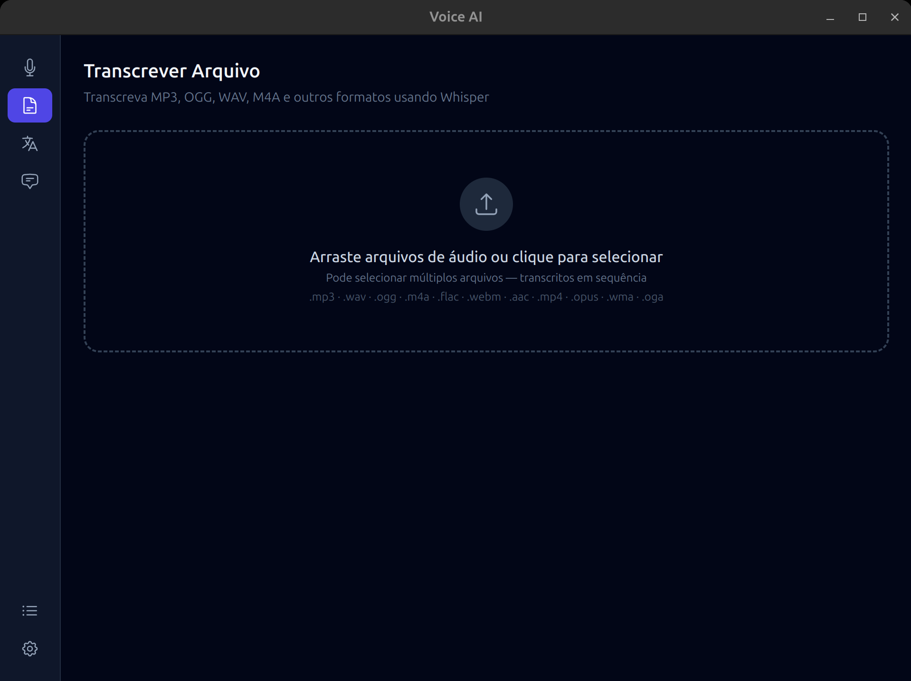
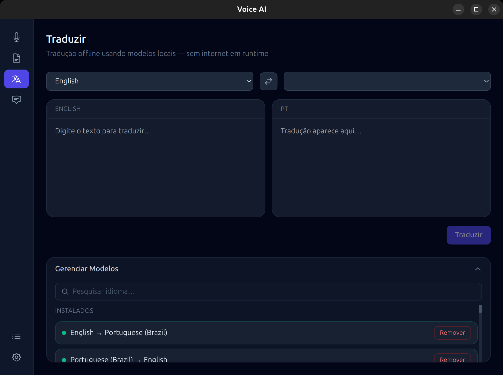
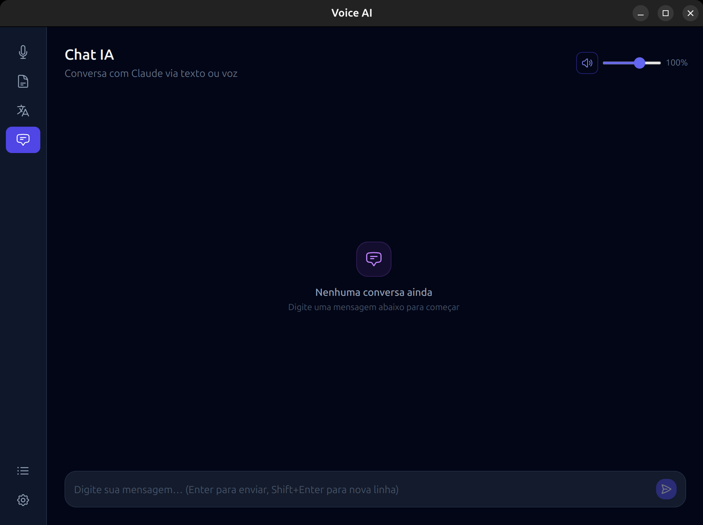
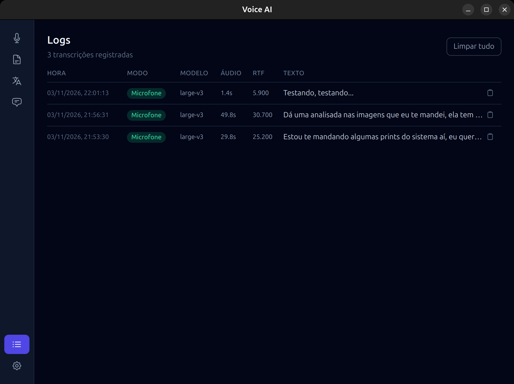
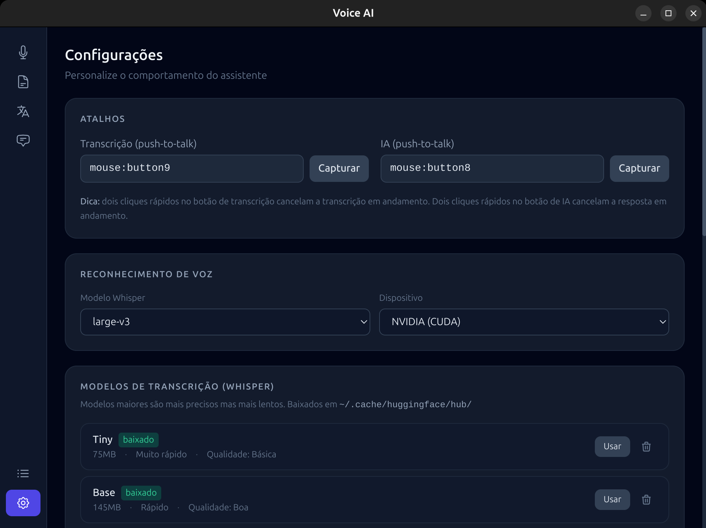

# Voice AI

Assistente de voz desktop com transcrição local, chat com IA e síntese de voz - tudo rodando no seu computador.

**Stack:** Electron + Vue 3 · FastAPI (Python) · Whisper (faster-whisper) · Claude · Edge TTS / ElevenLabs

---

## Funcionalidades

| Aba | O que faz |
|-----|-----------|
| 🎙 Transcrição de Microfone | Push-to-talk: grava, transcreve e copia o texto automaticamente |
| 📄 Transcrever Arquivo | Arraste ou selecione um áudio/vídeo e receba a transcrição completa |
| 🌐 Traduzir | Tradução offline (Argos Translate) entre dezenas de idiomas |
| 💬 Chat IA | Conversa por texto ou voz com Claude; histórico persistente, TTS com controle de volume |
| 📋 Logs | Histórico completo de transcrições com metadados (modelo, dispositivo, RTF) |
| ⚙️ Configurações | Atalhos de teclado/mouse, modelos Whisper com download integrado, TTS, system prompt |

---

## Como funciona

```
┌─────────────────────────────────────────────────┐
│                  Electron (frontend)             │
│  Vue 3 + Pinia + Tailwind CSS                   │
│  WebSocket (porta 18450) ←→ HTTP REST           │
└──────────────────┬──────────────────────────────┘
                   │
┌──────────────────▼──────────────────────────────┐
│               FastAPI (backend)                  │
│                                                  │
│  HotkeyManager ──► SpeechEngine (Whisper)        │
│        │               │                         │
│        │          transcrição                     │
│        │               │                         │
│        ▼               ▼                         │
│   Orchestrator ──► ClaudeBrain (stream)          │
│        │               │                         │
│        └──► TextToSpeech (Edge / ElevenLabs)     │
│                         │                         │
│            SQLite ◄─────┘  (chat + logs)         │
└─────────────────────────────────────────────────┘
```

### Fluxo de transcrição (push-to-talk)
1. Usuário mantém o botão pressionado (`mouse:button8` por padrão)
2. Áudio capturado em tempo real com `sounddevice`
3. Ao soltar: Whisper transcreve localmente
4. Texto copiado para o clipboard + exibido na tela

### Fluxo de resposta da IA (Ctrl + botão)
1. Usuário mantém `Ctrl + mouse:button8` e fala
2. Whisper transcreve a pergunta
3. Claude responde em streaming (frase a frase)
4. Cada frase é convertida em áudio pelo TTS em paralelo
5. Áudio reproduzido assim que pronto (pipeline de baixa latência)
6. Troca salva no banco e exibida no Chat IA

---

## Screenshots

<table>
  <tr>
    <td align="center">
      
      <br/><sub><b>Transcrição de Microfone</b> - estado em tempo real, nível de áudio</sub>
    </td>
    <td align="center">
      
      <br/><sub><b>Transcrever Arquivo</b> - drag & drop, múltiplos formatos</sub>
    </td>
  </tr>
  <tr>
    <td align="center">
      
      <br/><sub><b>Traduzir</b> - tradução offline, gerenciamento de pacotes de idioma</sub>
    </td>
    <td align="center">
      
      <br/><sub><b>Chat IA</b> - conversa por texto ou voz, controle de volume do TTS</sub>
    </td>
  </tr>
  <tr>
    <td align="center">
      
      <br/><sub><b>Logs</b> - histórico de transcrições com métricas de performance</sub>
    </td>
    <td align="center">
      
      <br/><sub><b>Configurações</b> - atalhos, modelos Whisper com download integrado</sub>
    </td>
  </tr>
</table>

---

## Pré-requisitos

### Sistema
- Linux (Ubuntu 20.04+)
- Python 3.11+
- Node.js 18+ (via nvm recomendado)
- `ffmpeg` e `aplay` (ALSA) instalados
- Microfone configurado

### GPU (opcional, mas recomendado)
- NVIDIA com drivers CUDA 11+ para aceleração do Whisper
- Sem GPU: modo CPU automático (mais lento, especialmente em modelos grandes)

---

## Instalação

```bash
git clone https://github.com/seu-usuario/voice-ai.git
cd voice-ai

# Backend
cd backend
python3 -m venv venv
source venv/bin/activate
pip install -r requirements.txt
cd ..

# Frontend
cd frontend
npm install
```

### Modelos Whisper

O `faster-whisper` baixa o modelo automaticamente no primeiro uso (HuggingFace cache em `~/.cache/huggingface/`).

| Modelo | Tamanho | Velocidade | Qualidade |
|--------|---------|-----------|-----------|
| `tiny` | ~75 MB | ⚡⚡⚡ | ★★☆ |
| `base` | ~145 MB | ⚡⚡⚡ | ★★★ |
| `small` | ~460 MB | ⚡⚡ | ★★★ |
| `medium` | ~1.5 GB | ⚡ | ★★★★ |
| `large-v3` | ~3 GB | 🐢 | ★★★★★ |

> O modelo é baixado na primeira transcrição. Para modelos grandes, pode levar alguns minutos dependendo da conexão.

---

## Rodando em desenvolvimento

```bash
# Terminal 1 - backend
cd backend
source venv/bin/activate
python -m backend.main

# Terminal 2 - frontend
cd frontend
npm run dev
```

Ou use o script integrado na raiz:

```bash
./dev.sh
```

---

## Build (distribuição)

### AppImage (Linux)

```bash
cd frontend
npm run build:linux
```

O AppImage gerado fica em `frontend/dist/`. Inclui o backend Python automaticamente (via `extraResources` no `electron-builder.yml`).

> **Nota sobre modelos:** o AppImage NÃO inclui os modelos Whisper (são arquivos grandes de até 3 GB). Na primeira execução o usuário deve ter conexão para download automático, ou pré-baixar com `python -c "from faster_whisper import WhisperModel; WhisperModel('medium')"`.

---

## Configurações

Todas as configurações ficam em `~/.local/share/voice-ai/settings.json`.

| Chave | Padrão | Descrição |
|-------|--------|-----------|
| `model` | `tiny` | Tamanho do modelo Whisper |
| `device` | `auto` | `auto` / `cuda` (NVIDIA) / `cpu` |
| `transcription_key` | `<ctrl>+t` | Atalho push-to-talk (transcrição) |
| `ai_key` | `<ctrl>+i` | Atalho push-to-talk (IA) |
| `tts_backend` | `edge` | `edge` (gratuito) ou `elevenlabs` (pago) |
| `edge_voice` | `pt-BR-AntonioNeural` | Voz Edge TTS |
| `elevenlabs_api_key` | - | Chave API ElevenLabs |
| `elevenlabs_voice_id` | - | ID da voz ElevenLabs |
| `claude_continue` | `true` | Manter contexto entre interações de voz |
| `claude_system_prompt` | - | System prompt customizado para o Claude |
| `sound_recording` | `true` | Som ao iniciar gravação |
| `sound_processing` | `true` | Som ao processar |
| `sound_copied` | `true` | Som ao copiar texto |

---

## Atalhos e gestos

| Ação | Padrão | Comportamento |
|------|--------|---------------|
| Transcrever | `Ctrl + T` (segurar) | Grava enquanto pressionado; solta para transcrever |
| Falar com IA | `Ctrl + I` (segurar) | Igual, mas envia para Claude |
| Cancelar transcrição | 2 cliques rápidos (transcrição) | Cancela gravação em andamento |
| Cancelar IA | 2 cliques rápidos (IA) | Para streaming e TTS imediatamente |

> Os atalhos podem ser qualquer tecla ou botão do mouse. Configure em **Configurações → Atalhos → Capturar**.

---

## Voz (TTS)

### Edge TTS (padrão, gratuito)
- Voz neural da Microsoft via internet
- Suporte a dezenas de idiomas e vozes
- Requer conexão com a internet

### ElevenLabs (pago, alta qualidade)
1. Crie uma conta em [elevenlabs.io](https://elevenlabs.io)
2. Obtenha a API key em Profile → API Keys
3. Em **Configurações → Síntese de Voz → ElevenLabs**, cole a chave e clique em **Buscar**
4. Selecione a voz desejada

---

## Tradução offline

A tradução usa [Argos Translate](https://github.com/argosopentech/argos-translate) e funciona **100% offline** após instalar os pacotes de idioma.

- Acesse a aba **Traduzir**
- Selecione os idiomas de origem e destino
- Clique em **Instalar** se o pacote ainda não estiver disponível
- Os pacotes ficam em `~/.local/share/argos-translate/`

---

## Arquitetura de pastas

```
voice-ai/
├── backend/
│   ├── main.py              # FastAPI app + WebSocket
│   ├── orchestrator.py      # Coordena engine, brain, TTS e hotkeys
│   ├── routes/
│   │   ├── chat.py          # POST /chat/message, GET /chat/history
│   │   ├── engine.py        # /engine/restart, /engine/tts/*
│   │   ├── transcribe.py    # POST /transcribe/file
│   │   ├── translate.py     # /translate/*
│   │   └── voices.py        # /voices/edge, /voices/elevenlabs/fetch
│   ├── services/
│   │   ├── brain.py         # Claude via CLI (streaming)
│   │   ├── hotkey_manager.py
│   │   ├── speech_engine.py # faster-whisper + sounddevice
│   │   └── tts.py           # Edge TTS / ElevenLabs + ffmpeg/aplay
│   └── settings_store.py    # Leitura/escrita de settings.json
├── frontend/
│   ├── src/
│   │   ├── main/            # Processo principal Electron
│   │   └── renderer/src/
│   │       ├── views/       # Cada aba do app
│   │       ├── stores/      # Pinia (chat, settings, status, translation)
│   │       ├── components/  # Sidebar, HotkeyCapture, ElevenLabsConfig…
│   │       └── api/         # HTTP + WebSocket client
│   └── electron-builder.yml
└── docs/
    ├── session-2026-11-03.md  # Log de bugs corrigidos
    └── features/
```

---

## Autostart com GNOME

Para iniciar automaticamente ao logar:

```bash
cp /path/to/voice-ai/voice-ai.desktop ~/.config/autostart/
```

O `start.sh` carrega o nvm antes de iniciar o frontend (necessário para ambientes sem nvm no PATH padrão do GNOME).

---

## Roadmap

- [ ] Download de modelos Whisper dentro do app (evitar bundling de arquivos grandes)
- [ ] Build para Windows
- [ ] Suporte a AMD GPU (ROCm)
- [ ] Indicador de status do TTS no overlay
